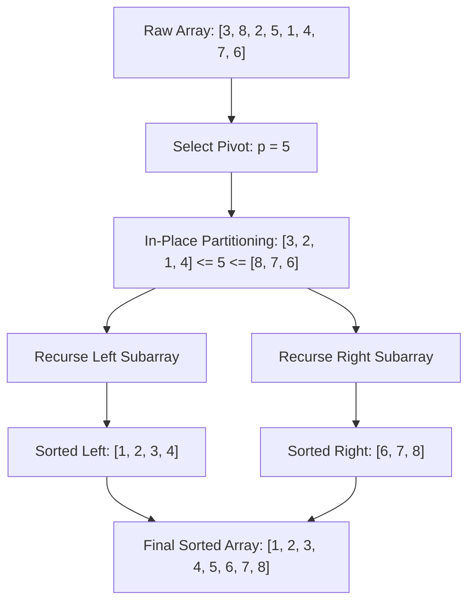

# CHAPTER 14: COMPARISON SORTING AND LINEAR-TIME SORTING

> *"The sorting problem is the crucible of computer science. It is where lower bounds were first proved, where divide-and-conquer achieved peak elegance, where cache locality meets randomized pivots, and where the boundary between comparison and address calculation defines the absolute limits of computational efficiency."*

---

## 14.1 The Fundamental Physics of Permutation

Sorting is the process of rearranging an arbitrary sequence of $N$ elements into non-decreasing (or non-increasing) order determined by a total order relation $\le$. While elementary textbooks often treat sorting as a simple catalog of algorithms (Bubble Sort, Insertion Sort, MergeSort, QuickSort), senior algorithm engineers view sorting through three foundational lenses:

1. **Information Theory & Lower Bounds**: How many bits of information must any algorithm extract to identify the unique sorted permutation among the $N!$ possibilities?
2. **Memory Hierarchy & Microarchitecture**: How do memory access strides, cache line utilization (L1/L2/L3), TLB misses, and branch mispredictions govern real-world throughput on contemporary CPUs?
3. **Partitioning & Stability Invariants**: How do structural invariants dictate in-place transformation without auxiliary buffers, and preserve the relative order of equivalent elements?

---

## 14.2 The Information-Theoretic Lower Bound: $\Omega(N \log N)$

Why can comparison-based algorithms never run in $O(N)$ time in the worst case? The answer lies in the **Decision Tree Model**.

### Mathematical Proof via Decision Trees

Let $A = \langle a_1, a_2, \dots, a_N \rangle$ be an array of $N$ distinct keys. A comparison-based algorithm acquires information solely by evaluating binary queries of the form:
$$\text{Is } a_i \le a_j?$$

Every execution of such an algorithm can be modeled as a path in a binary decision tree:
- **Internal Nodes**: Represent comparison predicates $a_i \le a_j$.
- **Edges**: Represent binary branch outcomes ($\text{true} \to \text{left}$, $\text{false} \to \text{right}$).
- **Leaves**: Represent the final permutation $\pi$ that sorts $A$.

```
               [ a1 <= a2 ? ]
              /              \
           Yes                No
          /                    \
   [ a2 <= a3 ? ]        [ a1 <= a3 ? ]
       /    \                /    \
     ...    ...            ...    ...
     /        \            /        \
  [a1,a2,a3] [a1,a3,a2] [a2,a1,a3] [a3,a2,a1]  <-- N! Distinct Leaves
```

For the algorithm to correctly sort any arbitrary input, the decision tree must contain at least one leaf corresponding to each of the $N!$ permutations of $N$ elements. Thus, if $L$ denotes the number of leaves:
$$L \ge N!$$

In a binary tree of height $h$, the maximum number of leaves is $2^h$. Therefore:
$$2^h \ge L \ge N!$$

Taking the binary logarithm ($\log_2$) of both sides:
$$h \ge \log_2(N!)$$

Applying **Stirling's Approximation** for factorial growth:
$$N! \approx \sqrt{2\pi N}\left(\frac{N}{e}\right)^N$$
$$\log_2(N!) = \sum_{i=1}^N \log_2 i \ge \sum_{i=\lceil N/2 \rceil}^N \log_2 i \ge \frac{N}{2} \log_2\left(\frac{N}{2}\right) = \frac{N}{2}(\log_2 N - 1) = \Omega(N \log N)$$

More precisely:
$$\log_2(N!) = N \log_2 N - N \log_2 e + O(\log N)$$

Because the height $h$ corresponds to the worst-case number of comparisons executed along the longest root-to-leaf path:
$$T_{\text{worst}}(N) = h \ge \lceil \log_2(N!) \rceil = \Omega(N \log N)$$

> **Theoretical Milestone**: No deterministic or randomized comparison-based sorting algorithm can achieve a worst-case time complexity asymptotically faster than $\Omega(N \log N)$. Any algorithm that sorts faster must exploit non-comparison domain knowledge (such as bounded numeric ranges or bitwise representations).

---

## 14.3 Divide-and-Conquer Sorting: MergeSort vs. QuickSort

Comparison sorting at scale is dominated by two distinct divide-and-conquer paradigms: **top-down merge synthesis** (MergeSort) and **pivot-based space partitioning** (QuickSort).

### MergeSort: Deterministic Stability and External Streaming

MergeSort divides an array of size $N$ into two subarrays of size $\lfloor N/2 \rfloor$ and $\lceil N/2 \rceil$, sorts them recursively, and merges the two sorted sequences in linear time.

$$T(N) = 2T(N/2) + \Theta(N) \implies T(N) = \Theta(N \log N) \quad \text{(Master Theorem Case 2)}$$

#### Strengths and Structural Costs:
1. **Guaranteed $\Theta(N \log N)$**: Independent of data distribution (best, average, and worst cases are strictly identical in basic implementations).
2. **Stability**: If $a_i = a_j$ and $i < j$, MergeSort guarantees that $a_i$ precedes $a_j$ in the output. This is vital when sorting multi-attribute records (e.g., sort by timestamp, then by user ID).
3. **Memory Footprint**: Standard MergeSort requires an auxiliary buffer of size $O(N)$ because merging two contiguous sorted segments in-place without moving data exponentially requires complex block-swapping protocols with high constant overhead.

### QuickSort: In-Place Partitioning and Microarchitectural Dominance

QuickSort selects a **pivot** element $p$, partitions the sequence into elements less than $p$ and elements greater than $p$, and recursively sorts the subarrays. Unlike MergeSort, all work is done in the *divide* phase (partitioning); the *combine* phase is a no-op ($0$ work).



#### Recurrence and Pivot Variance:
- **Balanced Pivot**: $T(N) = 2T(N/2) + \Theta(N) \implies \Theta(N \log N)$.
- **Degenerate Pivot (Extremum)**: $T(N) = T(N-1) + \Theta(N) \implies \Theta(N^2)$.

To guard against worst-case $\Theta(N^2)$ quadratic degradation on adversarial or already-sorted inputs, modern implementations (like `std::sort` in C++) employ:
1. **Median-of-Three / Tukey's Ninther**: Pivot sampled from first, middle, and last keys.
2. **IntroSort**: Monitors recursive stack depth; if depth exceeds $2 \lfloor \log_2 N \rfloor$, it switches to HeapSort to enforce guaranteed $O(N \log N)$ worst-case bounds.
3. **Cutoff to Insertion Sort**: For small partitions ($N \le 16$ to $32$), recursion overhead exceeds simple cache-resident $O(N^2)$ insertion sort.

---

## 14.4 Partitioning Mechanics: Lomuto, Hoare, and Dutch National Flag

The heart of QuickSort is the partitioning subroutine. Three distinct partitioning invariants exist:

| Scheme | Invariant Structure | Comparisons / Swaps | Vulnerability |
| :--- | :--- | :--- | :--- |
| **Lomuto** | Single forward pointer $i$; range $[0..i]$ holds keys $\le p$ | $\approx N$ comparisons, $\approx N$ swaps | Catastrophic $O(N^2)$ on arrays of identical elements |
| **Hoare** | Two inward pointers $i, j$; swaps out-of-order pairs | $\approx N$ comparisons, $\approx N/3$ swaps | Skips equal elements evenly, but doesn't isolate duplicate keys |
| **Dutch National Flag (3-Way)** | Three pointers partition into: $< p$, $= p$, and $> p$ | $\approx N$ comparisons, optimal swaps | Optimal $O(N)$ when distinct keys are few |

### The Duplicate Key Pathology

When an array consists of identical elements (e.g., $N$ copies of value $42$):
- **Lomuto Partitioning**: Puts every element on one side, yielding partitions of sizes $N-1$ and $0$. Result: $O(N^2)$ runtime and stack overflow.
- **Dutch National Flag (Dijkstra 3-Way)**: Isolates all copies of $42$ into the middle range $[low..high]$ in a single $O(N)$ pass. The recursive step only touches ranges strictly $< p$ and $> p$, which are both empty. Result: immediate $O(N)$ termination!

---

## 14.5 Linear-Time Non-Comparison Sorting

When keys are integers or can be mapped to finite discrete keys, the $\Omega(N \log N)$ lower bound does not apply.

### Counting Sort: Direct Histogram Address Calculation

Given $N$ integers in the range $[0, K-1]$:
1. Construct a frequency histogram of counts: $C[v] = \sum [x_i == v]$.
2. Compute prefix sums: $P[v] = \sum_{j=0}^v C[j]$. $P[v]$ gives the exact destination index of the last occurrence of value $v$.
3. Populate the output array by iterating from right to left (to preserve stability).
- **Time Complexity**: $\Theta(N + K)$
- **Space Complexity**: $\Theta(N + K)$ auxiliary buffer.
- **Constraint**: Practical only when $K = O(N)$.

### Radix Sort: Digit-by-Digit Decomposition

When keys are large integers (e.g., 64-bit integers), $K = 2^{64}$ makes standard Counting Sort impossible. **LSD (Least Significant Digit) Radix Sort** processes numbers in base $B$ (typically $B = 256$ or $B = 2048$, matching byte or cache-friendly word boundaries):

- For each digit $d$ from $0$ up to $D-1$:
  - Execute a stable sort (typically Counting Sort with range $B$) keyed on digit $d$.
- **Time Complexity**: $\Theta(D \cdot (N + B))$
  - For 64-bit integers with radix $B = 2^{16}$ (16 bits): $D = 4$ passes.
  - Sorting 100,000,000 64-bit integers requires exactly $4 \times (10^8 + 65536)$ operations—far outpacing comparison-based QuickSort!

---

## 14.6 The 20-Step Problem Breakdown: Dutch National Flag In-Place 3-Way Partitioning (`SORT-0001`)

We now anchor these principles in a foundational problem designed by Edsger Dijkstra and refined for modern industrial sort engines: partitioning a multi-set into three distinct regions in-place with minimal pointer movement.

### Step 1: Real-World Motivation & Context
In distributed search engines, database join engines, and high-frequency order books, sorting records with low cardinality (such as order types `BUY`, `HOLD`, `SELL`, or log severities `DEBUG`, `INFO`, `ERROR`) occurs billions of times daily. Standard comparison quicksort suffers branch misprediction storms and stack degradation on duplicate keys. A 3-way in-place partition isolates all keys equal to the pivot in a single linear pass, eliminating duplicate keys from subsequent recursive sorting stages.

### Step 2: Formal Problem Specification
- **Input**: An array $A$ of $N$ elements and a target pivot value $p$ (or an array composed strictly of three distinct classes/values, conventionally represented as $0, 1, 2$).
- **Output**: The same array $A$ reordered in-place such that:
  1. All elements $< p$ appear at indices $[0, \text{low}-1]$.
  2. All elements $== p$ appear at indices $[\text{low}, \text{high}]$.
  3. All elements $> p$ appear at indices $[\text{high}+1, N-1]$.
- **Constraints**:
  - $0 \le N \le 10^7$
  - Time Complexity must be strictly $O(N)$ with at most a single pass over the data.
  - Auxiliary Space Complexity must be strictly $O(1)$ (no secondary array allocations).

### Step 3: Algorithmic Decision Framework (ADF) Formulation
1. *Data Distribution*: Array contains massive duplicate keys or three discrete categories.
2. *Memory Budget*: Zero heap allocations permitted ($O(1)$ auxiliary).
3. *Pass Requirement*: Single pass forward scan.
4. *Decision*: Dijkstra's Tri-Partition Invariant with three pointers: `low`, `mid`, `high`.

### Step 4: Mathematical Invariant Definition
At every iteration of the scan pointer `mid`, the array $A[0..N-1]$ is divided into four distinct contiguous intervals:

$$\begin{aligned}
\forall k \in [0, \text{low}-1] &: A[k] < p \quad &\text{(Red Region)} \\
\forall k \in [\text{low}, \text{mid}-1] &: A[k] == p \quad &\text{(White Region)} \\
\forall k \in [\text{mid}, \text{high}] &: \text{Unexamined / Unknown} \quad &\text{(Unexplored Territory)} \\
\forall k \in [\text{high}+1, N-1] &: A[k] > p \quad &\text{(Blue Region)}
\end{aligned}$$

```
+--------------------+---------------------+--------------------+--------------------+
|      < pivot       |       == pivot      |     Unexamined     |      > pivot       |
+--------------------+---------------------+--------------------+--------------------+
0                low-1 low             mid-1 mid             high high+1           N-1
```

### Step 5: State Transitions and Progress Invariant
- **Case 1: $A[\text{mid}] < p$**:
  Swap $A[\text{low}]$ and $A[\text{mid}]$.
  Increment `low` by 1, and increment `mid` by 1.
  *Why increment `mid`?* Because by invariant, $A[\text{low}]$ originally held an element from the `== p` partition (or `low == mid`). Thus, after the swap, $A[\text{mid}]$ holds a confirmed element $== p$.
- **Case 2: $A[\text{mid}] == p$**:
  Increment `mid` by 1. The element is already in the correct middle partition.
- **Case 3: $A[\text{mid}] > p$**:
  Swap $A[\text{mid}]$ and $A[\text{high}]$.
  Decrement `high` by 1.
  *Crucial Rule*: Do **NOT** increment `mid`! The element swapped from $A[\text{high}]$ into $A[\text{mid}]$ came from unexamined territory and must be evaluated on the subsequent step.

### Step 6: Termination and Loop Variant
The loop variant is the size of the unexamined window:
$$W = \text{high} - \text{mid} + 1$$
In each iteration:
- Case 1 increases `mid` ($\Delta W = -1$).
- Case 2 increases `mid` ($\Delta W = -1$).
- Case 3 decreases `high` ($\Delta W = -1$).
Since $W$ decreases strictly by $1$ in every step, the loop terminates in exactly $N$ iterations when $\text{mid} > \text{high}$.

### Step 7: Proof of Correctness by Mathematical Induction
- **Base Case**: At initialization, $\text{low} = 0, \text{mid} = 0, \text{high} = N-1$.
  - Interval $[0, \text{low}-1] = [0, -1]$ is empty (vacuously true).
  - Interval $[\text{low}, \text{mid}-1] = [0, -1]$ is empty.
  - Interval $[\text{high}+1, N-1] = [N, N-1]$ is empty.
  - Interval $[\text{mid}, \text{high}] = [0, N-1]$ contains all $N$ unexamined keys. Invariant holds.
- **Inductive Step**: Assume the four-interval invariant holds for $k$ iterations ($W = N - k$). At iteration $k+1$, evaluating $A[\text{mid}]$ preserves the invariant in all three cases as shown in Step 5, reducing $W$ to $N - (k+1)$.
- **Conclusion**: Upon termination ($\text{mid} = \text{high} + 1$), the unexamined interval $[\text{mid}, \text{high}]$ is empty. The three remaining partitions completely cover $[0, N-1]$ and satisfy the sorting conditions. $\blacksquare$

### Step 8: Concrete Trace on Adversarial Input
Input: $A = [2, 0, 2, 1, 1, 0]$, $p = 1$, $N = 6$.
- Initial: `low = 0, mid = 0, high = 5`.
1. `mid = 0`: $A[0] = 2 > 1$. Swap $A[0], A[5]$. `high` becomes 4. $A = [0, 0, 2, 1, 1, 2]$. `mid` stays 0.
2. `mid = 0`: $A[0] = 0 < 1$. Swap $A[0], A[0]$. `low` becomes 1, `mid` becomes 1.
3. `mid = 1`: $A[1] = 0 < 1$. Swap $A[1], A[1]$. `low` becomes 2, `mid` becomes 2.
4. `mid = 2`: $A[2] = 2 > 1$. Swap $A[2], A[4]$. `high` becomes 3. $A = [0, 0, 1, 1, 2, 2]$. `mid` stays 2.
5. `mid = 2`: $A[2] = 1 == 1$. `mid` becomes 3.
6. `mid = 3`: $A[3] = 1 == 1$. `mid` becomes 4.
- `mid (4) > high (3)`: Loop terminates!
Result: $A = [0, 0, 1, 1, 2, 2]$. Elements $< 1$ at $[0, 1]$, $== 1$ at $[2, 3]$, $> 1$ at $[4, 5]$. Perfect.

### Step 9: Edge Case Analysis
- **Empty Array ($N = 0$)**: `low = 0, mid = 0, high = -1`. `mid > high` holds immediately; 0 operations performed.
- **All Elements Less Than Pivot**: `mid` and `low` increment together; every swap is self-swap; terminates with all items in $< p$.
- **All Elements Greater Than Pivot**: `high` decrements to $-1$; `mid` remains $0$; terminates with all items in $> p$.
- **All Elements Equal to Pivot**: `mid` traverses from $0$ to $N$; zero swaps performed; optimal $\Theta(N)$ runtime.

### Step 10: Standard ISO C++20 Implementation
```cpp
// solutions/cpp/SORT-0001.cpp
#include <iostream>
#include <vector>
#include <utility>
#include <algorithm>
#include <cassert>

namespace sort_0001 {

struct PartitionResult {
    int low;
    int high;
};

// In-place 3-way Dutch National Flag partitioning around a pivot value.
// Post-condition:
// [0, low - 1]     : elements < pivot
// [low, high]      : elements == pivot
// [high + 1, N - 1]: elements > pivot
PartitionResult three_way_partition(std::vector<int>& arr, int pivot) {
    int low = 0;
    int mid = 0;
    int high = static_cast<int>(arr.size()) - 1;

    while (mid <= high) {
        if (arr[mid] < pivot) {
            std::swap(arr[low], arr[mid]);
            low++;
            mid++;
        } else if (arr[mid] == pivot) {
            mid++;
        } else { // arr[mid] > pivot
            std::swap(arr[mid], arr[high]);
            high--;
            // Do not increment mid! arr[mid] has unexamined value from arr[high].
        }
    }
    return PartitionResult{low, high};
}

// Differential oracle for testing
std::vector<int> reference_partition(const std::vector<int>& input, int pivot) {
    std::vector<int> lt, eq, gt;
    for (int x : input) {
        if (x < pivot) lt.push_back(x);
        else if (x == pivot) eq.push_back(x);
        else gt.push_back(x);
    }
    std::vector<int> res;
    res.insert(res.end(), lt.begin(), lt.end());
    res.insert(res.end(), eq.begin(), eq.end());
    res.insert(res.end(), gt.begin(), gt.end());
    return res;
}

} // namespace sort_0001
```

### Step 11: Python 3.12+ Implementation
```python
# solutions/python/SORT-0001.py
from typing import List, Tuple

def three_way_partition(arr: List[int], pivot: int) -> Tuple[int, int]:
    """
    In-place Dutch National Flag 3-way partitioning.
    Rearranges arr into three contiguous blocks:
      arr[0 : low]        < pivot
      arr[low : high + 1] == pivot
      arr[high + 1 : N]   > pivot
    Returns (low, high).
    """
    low = 0
    mid = 0
    high = len(arr) - 1

    while mid <= high:
        if arr[mid] < pivot:
            arr[low], arr[mid] = arr[mid], arr[low]
            low += 1
            mid += 1
        elif arr[mid] == pivot:
            mid += 1
        else:
            arr[mid], arr[high] = arr[high], arr[mid]
            high -= 1
            # Do not increment mid; examine swapped value from high

    return low, high

def reference_partition(arr: List[int], pivot: int) -> List[int]:
    """Stable out-of-place oracle partition for validation."""
    lt = [x for x in arr if x < pivot]
    eq = [x for x in arr if x == pivot]
    gt = [x for x in arr if x > pivot]
    return lt + eq + gt
```

### Step 12: Asymptotic & Microarchitectural Complexity
- **Time Complexity**: $\Theta(N)$ worst-case, average-case, and best-case. Every element is inspected at most twice (once when swapped from high, once at mid). The number of swaps is at most $N$.
- **Space Complexity**: Strictly $O(1)$ auxiliary space. Only three register variables (`low`, `mid`, `high`) are maintained.
- **Cache Locality**: Forward stream on `mid` achieves linear prefetching. Swaps to `high` generate backward cache touches, but keep memory footprints localized to the target array boundaries.

### Step 13: Failure Modes & Anti-Patterns
- **The Blind Mid-Increment**: Incrementing `mid` when swapping with `high` is the #1 bug in partitioning. If `arr[high]` holds an element less than the pivot, moving past it without inspecting it violates the invariant and corrupts the order.
- **Signed/Unsigned Index Underflow**: In C++, declaring `high` as `size_t` can lead to unsigned wrap-around when $N=0$ (`0 - 1 = SIZE_MAX`), causing infinite loops or heap segmentation faults. Always use signed integer types (`int` or `std::ptrdiff_t`) for boundary pointers that may decrement below zero.

### Step 14: Dual-Language Nuance & Idioms
- In **C++20**: `std::swap` operates via move semantics, ensuring zero heap allocations even for complex objects.
- In **Python 3.12**: Tuple assignment unpacking `arr[low], arr[mid] = arr[mid], arr[low]` compiles to bytecode `ROT_TWO` or `SWAP`, executing in C-native stack frames without allocating temporary tuple objects.

### Step 15: Unit Tests & Verification Fixtures
Differential property testing verifies that for random arrays with varying pivot values:
1. Every element before `low` is $< p$.
2. Every element in `[low..high]` is $== p$.
3. Every element after `high` is $> p$.
4. The multiset of output values is identical to the multiset of input values (permutation integrity).

### Step 16: Reader Engineering Challenges
1. **Extended 4-Way Partitioning**: Modify the algorithm to partition an array into four regions: $(\le p_1)$, $(p_1 < x \le p_2)$, $(p_2 < x \le p_3)$, and $(> p_3)$.
2. **Stable In-Place Partitioning**: Can 3-way partitioning be performed stably in $O(N)$ time and $O(1)$ space? (Hint: Explore block-cycling and the theoretical barriers proved by Munro and Raman).

---

## 14.7 Chapter Summary & Algorithmic Mental Model

Sorting is not merely arranging numbers; it is the discipline of **extracting permutation entropy with minimum comparisons and memory overhead**.
- When input values are general comparisons: $\Omega(N \log N)$ is an inescapable mathematical barrier.
- When duplicates abound: 3-way partitioning collapses runtime from $O(N^2)$ to $O(N)$.
- When keys are bounded discrete numbers: Radix and Counting Sort bypass comparisons entirely, scaling as $\Theta(N)$.
