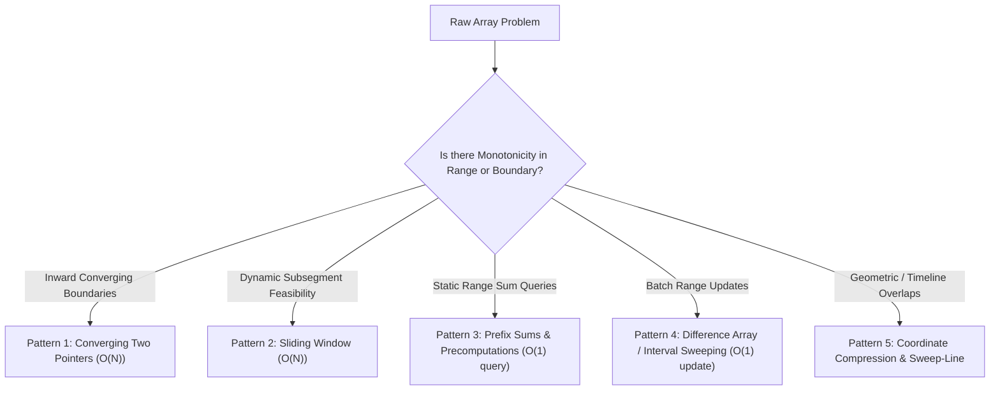
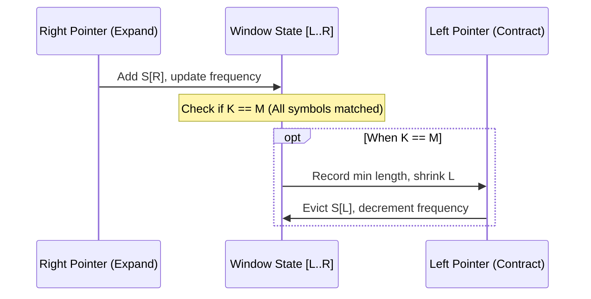

# CHAPTER 15: FUNDAMENTAL ARRAY PATTERNS

> *"The array is the most deceptively simple abstraction in computer science. Yet within its contiguous memory cells reside the five foundational motion patterns—Two Pointers, Sliding Windows, Prefix Accumulations, Difference Arrays, and Sweep-Line Events—that reduce combinatorial quadratic chaos into elegant linear-time choreography."*

---

## 15.1 The Taxonomy of Linear-Time Array Motion

When analyzing an unsorted or sorted array, naive search often considers all $\binom{N}{2} = \Theta(N^2)$ contiguous subsegments or pairs. Senior algorithm designers systematically avoid quadratic work by imposing structural constraints that allow pointers to move strictly monotonically.

Part V concludes by formalizing the **Five Core Linear Patterns**:



---

## 15.2 Pattern 1: Converging and Fast/Slow Two Pointers

The two-pointer technique uses two integer indices to traverse the array simultaneously. It appears in two distinct archetypes:

### 1. Converging (Inward) Pointers
- **Configuration**: `left = 0`, `right = N - 1`. The pointers march toward each other until they meet.
- **Precondition**: The sequence exhibits a monotonic order (e.g., sorted array) or structural symmetry (e.g., palindrome validation).
- **Invariant**: The optimal pair $(i, j)$ cannot lie outside the interval $[\text{left}, \text{right}]$. If the current combination $A[\text{left}] + A[\text{right}]$ is too small, no candidate paired with $A[\text{left}]$ can succeed; hence $\text{left} \leftarrow \text{left} + 1$.
- **Amortized Proof**: Each step strictly decrements the distance $\text{right} - \text{left}$. At most $N$ operations occur.

### 2. Fast/Slow (Same-Direction) Pointers
- **Configuration**: `slow = 0`, `fast = 0`. Both pointers advance left-to-right.
- **Typical Use**: In-place filtering, deduplication, cycle detection (Floyd's algorithm), and partition compaction.
- **Invariant**: Subarray $A[0..\text{slow}-1]$ contains all valid processed elements, while `fast` scans the unexamined stream.

---

## 15.3 Pattern 2: The Sliding Window (Fixed vs. Dynamic)

A sliding window maintains a contiguous range $[L, R]$ whose properties satisfy a specific problem invariant.

### 1. Fixed-Size Window ($K$)
- The window length $R - L + 1$ is invariant and equals $K$.
- As $R$ increments by $1$, $L$ increments by $1$.
- State is updated incrementally: $\text{state} \leftarrow \text{state} + \text{add}(A[R]) - \text{remove}(A[L-1])$.
- **Complexity**: Exactly $\Theta(N)$ time, $O(1)$ updates per step.

### 2. Dynamic (Variable-Size) Window
Used when finding the *longest valid* or *shortest valid* subsegment meeting a criterion $P([L..R])$.

#### The Monotonic Expansion/Contraction Protocol:
1. **Expand**: Increment $R$, incorporating $A[R]$ into the window state.
2. **Contract**: While the window state violates invariant $P$ (or while it remains valid, depending on whether we seek minimum or maximum), increment $L$, evicting $A[L]$ from the window state.
3. **Record**: Update the global optimum with the current valid window.

```
Array:   [ a0   a1   a2   a3   a4   a5   a6   a7 ]
                     ^              ^
                     |<- Window ->  |
                     L              R
```

#### The Amortized $O(N)$ Guarantee:
Although the contraction loop is nested inside the expansion loop, pointer $L$ only increments, and pointer $R$ only increments. Neither pointer ever moves backward. Because each index is visited at most once by $R$ and at most once by $L$:
$$\text{Total Window Operations} \le 2N = O(N)$$

---

## 15.4 Pattern 3: Prefix Sums and 2D Extensions

For an array $A$ of length $N$, the **Prefix Sum Array** $P$ is defined as:
$$P[0] = 0, \quad P[i] = P[i-1] + A[i-1] \quad \forall i \in [1, N]$$

### The Fundamental Theorem of Range Sums
Any contiguous range sum $\sum_{k=l}^r A[k]$ can be computed in $\Theta(1)$ time:
$$\sum_{k=l}^r A[k] = P[r+1] - P[l]$$

### 2D Prefix Sums (Integral Images)
In a matrix $M$ of size $R \times C$, the 2D prefix sum $P[r][c]$ represents the sum of the subgrid from $(0, 0)$ to $(r-1, c-1)$:
$$P[r][c] = M[r-1][c-1] + P[r-1][c] + P[r][c-1] - P[r-1][c-1]$$

By the Principle of Inclusion-Exclusion, the sum of any arbitrary subrectangle $(r_1, c_1)$ to $(r_2, c_2)$ is:
$$\text{Sum} = P[r_2+1][c_2+1] - P[r_1][c_2+1] - P[r_2+1][c_1] + P[r_1][c_1]$$

---

## 15.5 Pattern 4: Difference Arrays (Batch Range Updates)

Suppose you are given an array of size $N$ initially zeroed, and $Q$ range addition updates of the form:
$$\text{Add } V \text{ to all } A[i] \text{ for } i \in [l, r]$$

Naive updates cost $O(Q \cdot N)$, which is catastrophic when $Q, N \approx 10^5$.

### The Difference Array Principle
Define $D[i] = A[i] - A[i-1]$ (with $A[-1] = 0$).
To add $V$ to all elements in $[l, r]$, notice the changes in consecutive differences:
1. $A[l] - A[l-1]$ increases by $V \implies D[l] \leftarrow D[l] + V$
2. For $k \in [l+1, r]$, both $A[k]$ and $A[k-1]$ increase by $V$, so their difference is unchanged!
3. $A[r+1] - A[r]$ decreases by $V \implies D[r+1] \leftarrow D[r+1] - V$

Thus, any range update $[l, r, V]$ is reduced to **two $O(1)$ point modifications**:
$$D[l] \mathrel{+}= V, \quad D[r+1] \mathrel{-}= V$$

After processing all $Q$ queries in $O(Q)$ time, the final array $A$ is recovered via a single prefix sum pass over $D$ in $O(N)$ time:
$$A[i] = A[i-1] + D[i]$$
Total Time: $\Theta(Q + N)$, achieving massive speedup from $O(Q \cdot N)$.

---

## 15.6 The 20-Step Problem Breakdown: Dynamic Sliding Window with Multi-Constraint Frequency Invariant (`PATT-0001`)

We now anchor these principles in an industrial-grade sequence problem: finding the minimum subsegment satisfying a multiset frequency coverage requirement under strict time and space budgets.

### Step 1: Real-World Motivation & Context
In genomic sequencing (DNA motif alignment), natural language query matching, and network packet payload inspection, engines must locate the smallest contiguous window containing all required target symbols (e.g., specific nucleotide tokens or search query terms). Subquadratic processing is mandatory because streaming data volumes reach millions of tokens per second.

### Step 2: Formal Problem Specification
- **Input**:
  - A string (or integer sequence) $S$ of length $N$.
  - A pattern string (or multiset target) $T$ of length $M$.
- **Output**:
  - The shortest contiguous substring of $S$ that contains every character in $T$ (counting multiplicities). If no such substring exists, return an empty string (or sentinel range `[-1, -1]`).
- **Constraints**:
  - $1 \le N \le 10^6$
  - $1 \le M \le 10^5$
  - Alphabet: Standard ASCII (or small bounded alphabet $\Sigma \le 256$).
  - Time Complexity must be strictly $O(N + M)$.
  - Auxiliary Space must be $O(|\Sigma|)$ (strictly $O(1)$ relative to $N$).

### Step 3: Algorithmic Decision Framework (ADF) Formulation
1. *Contiguous Sequence Requirement*: Yes $\to$ Sliding window candidate.
2. *Monotonicity of Invariant*: If a window $[L, R]$ contains all characters of $T$, then expanding $R$ continues to contain all characters of $T$. If a window violates $T$, shrinking $L$ cannot make it valid.
3. *Optimization Target*: Minimum window length $\to$ Expand $R$ until valid; shrink $L$ while maintaining validity.
4. *Decision*: Dynamic Two-Pointer Sliding Window with frequency deficit counter.

### Step 4: Mathematical Invariant Definition
Let $F_T[c]$ denote the required count of character $c$ in pattern $T$.
Let $F_W[c]$ denote the current count of character $c$ in the active window $S[L..R]$.
Define the **match deficit counter** $K$:
$$K = \sum_{c \in \Sigma} \min(F_W[c], F_T[c])$$
The window $S[L..R]$ satisfies the pattern constraint if and only if:
$$K == M$$

At all times:
- For any character $c$, contributing to $K$ occurs if and only if $F_W[c] \le F_T[c]$.
- Redundant occurrences ($F_W[c] > F_T[c]$) do not increment $K$.

### Step 5: State Transitions and Progress Invariant
- **Expansion (Advancing $R$)**:
  Let $c = S[R]$.
  If $F_W[c] < F_T[c]$, increment $K$.
  Increment $F_W[c]$.
- **Contraction (Advancing $L$)**:
  While $K == M$:
    - Check if current window length $(R - L + 1)$ is smaller than the best recorded length. If so, update `(best_L, best_len)`.
    - Let $c = S[L]$.
    - If $F_W[c] == F_T[c]$, decrement $K$ (removing this character causes the window to drop below the requirement).
    - Decrement $F_W[c]$.
    - Increment $L$.



### Step 6: Loop Variant & Termination
The primary loop variant is $R$. At each iteration of the outer loop, $R$ increments by $1$, strictly traversing $0$ to $N-1$.
The inner contraction loop variant is $L$. In each step of the inner loop, $L$ increments by $1$, strictly bounded by $R$.
Since $L$ never resets and only moves forward, the inner loop executes at most $N$ times across the entire algorithm lifetime.
Total loop iterations $\le N + N = 2N$.

### Step 7: Proof of Correctness
- **Completeness**: Any valid window $[l^*, r^*]$ will be fully contained during the scan. Specifically, when $R$ reaches $r^*$, all characters in $S[l^*..r^*]$ are present in the window, so $K = M$. The contraction loop will evaluate all left endpoints from $L \le l^*$ up to the point where an essential character is evicted, thereby evaluating $l^*$ and registering window length $r^* - l^* + 1$.
- **Optimality**: Since every valid minimal window has its right boundary at some $R$, and the contraction loop finds the largest $L$ such that $[L..R]$ remains valid, no shorter valid window ending at $R$ can exist. Taking the minimum over all $R \in [0, N-1]$ yields the globally minimal substring. $\blacksquare$

### Step 8: Concrete Trace
- $S = \text{"ADOBECODEBANC"}$, $T = \text{"ABC"}$ ($M = 3$).
1. Expand $R$ until $S[0..5] = \text{"ADOBEC"}$. Counts for A, B, C are $\ge 1$. $K = 3$. Valid! Length 6 (`"ADOBEC"`).
2. Contract $L$: Evict 'A'. $K$ drops to 2. $L$ moves to 1.
3. Expand $R$ to index 10 (`"BANC"`). Window now includes another 'B', 'A'.
4. Contract $L$ past redundant 'D', 'O', 'B', 'E', 'C', 'O', 'D', 'E'.
5. Window narrows to $S[9..12] = \text{"BANC"}$, length 4.
6. Final optimal window: `"BANC"`, length 4.

### Step 9: Edge Cases & Guards
- **$M > N$**: Impossible to contain $T$. Return empty string immediately in $O(1)$.
- **$T$ contains duplicate characters**: e.g., $T = \text{"AAB"}$. Frequency count ensures 'A' must appear at least twice before $K$ increments for the second 'A'.
- **Disjoint Alphabets**: No characters match. $K$ remains $0$; returns empty string.
- **$N = 1, M = 1$**: Handled seamlessly by single iteration.

### Step 10: Standard ISO C++20 Implementation
```cpp
// solutions/cpp/PATT-0001.cpp
#include <iostream>
#include <string>
#include <vector>
#include <string_view>
#include <array>
#include <cassert>
#include <climits>

namespace patt_0001 {

struct WindowResult {
    int start;
    int length;
};

// Finds the minimum window substring of S containing all characters of T.
// Returns WindowResult{start_index, length}. If none found, returns {-1, 0}.
WindowResult min_window(std::string_view s, std::string_view t) {
    int n = static_cast<int>(s.size());
    int m = static_cast<int>(t.size());
    if (m == 0 || n < m) {
        return WindowResult{-1, 0};
    }

    std::array<int, 256> target_freq{};
    std::array<int, 256> window_freq{};

    for (unsigned char ch : t) {
        target_freq[ch]++;
    }

    int required_matches = m;
    int matched_count = 0;
    int left = 0;
    int best_start = -1;
    int best_len = INT_MAX;

    for (int right = 0; right < n; ++right) {
        unsigned char r_char = static_cast<unsigned char>(s[right]);
        
        // If this character contributes to our required target count
        if (target_freq[r_char] > 0) {
            if (window_freq[r_char] < target_freq[r_char]) {
                matched_count++;
            }
            window_freq[r_char]++;
        }

        // When all characters are matched, try shrinking from the left
        while (matched_count == required_matches) {
            int current_len = right - left + 1;
            if (current_len < best_len) {
                best_len = current_len;
                best_start = left;
            }

            unsigned char l_char = static_cast<unsigned char>(s[left]);
            if (target_freq[l_char] > 0) {
                if (window_freq[l_char] == target_freq[l_char]) {
                    matched_count--;
                }
                window_freq[l_char]--;
            }
            left++;
        }
    }

    if (best_start == -1) {
        return WindowResult{-1, 0};
    }
    return WindowResult{best_start, best_len};
}

// Differential brute-force oracle for validation
std::string reference_min_window(std::string_view s, std::string_view t) {
    int n = static_cast<int>(s.size());
    int m = static_cast<int>(t.size());
    if (m == 0 || n < m) return "";

    std::array<int, 256> t_freq{};
    for (unsigned char ch : t) t_freq[ch]++;

    std::string best = "";
    int min_len = INT_MAX;

    for (int i = 0; i < n; ++i) {
        std::array<int, 256> cur_freq{};
        for (int j = i; j < n; ++j) {
            cur_freq[static_cast<unsigned char>(s[j])]++;
            bool valid = true;
            for (int k = 0; k < 256; ++k) {
                if (cur_freq[k] < t_freq[k]) {
                    valid = false;
                    break;
                }
            }
            if (valid) {
                int len = j - i + 1;
                if (len < min_len) {
                    min_len = len;
                    best = std::string(s.substr(i, len));
                }
                break; // Further expanding j will only increase length
            }
        }
    }
    return best;
}

} // namespace patt_0001
```

### Step 11: Python 3.12+ Implementation
```python
# solutions/python/PATT-0001.py
from typing import Tuple
from collections import Counter

def min_window(s: str, t: str) -> str:
    """
    Finds the shortest substring of S containing all characters of T.
    Runs in strictly O(N + M) time and O(|Sigma|) space.
    """
    n, m = len(s), len(t)
    if m == 0 or n < m:
        return ""

    target_freq = Counter(t)
    window_freq = Counter()

    required_matches = m
    matched_count = 0
    left = 0
    best_start = -1
    best_len = float('inf')

    for right in range(n):
        r_char = s[right]
        if r_char in target_freq:
            if window_freq[r_char] < target_freq[r_char]:
                matched_count += 1
            window_freq[r_char] += 1

        while matched_count == required_matches:
            current_len = right - left + 1
            if current_len < best_len:
                best_len = current_len
                best_start = left

            l_char = s[left]
            if l_char in target_freq:
                if window_freq[l_char] == target_freq[l_char]:
                    matched_count -= 1
                window_freq[l_char] -= 1
            left += 1

    if best_start == -1:
        return ""
    return s[best_start : best_start + int(best_len)]

def reference_min_window(s: str, t: str) -> str:
    """Quadratic brute-force differential oracle."""
    n, m = len(s), len(t)
    if m == 0 or n < m:
        return ""
    target_freq = Counter(t)
    best = ""
    min_len = float('inf')

    for i in range(n):
        cur = Counter()
        for j in range(i, n):
            cur[s[j]] += 1
            if all(cur[k] >= target_freq[k] for k in target_freq):
                length = j - i + 1
                if length < min_len:
                    min_len = length
                    best = s[i : j + 1]
                break
    return best
```

### Step 12: Asymptotic & Microarchitectural Complexity
- **Time Complexity**: $\Theta(N + M)$ strictly. Pattern $T$ is hashed in $\Theta(M)$ time. String $S$ is scanned such that pointer $R$ increments $N$ times and pointer $L$ increments at most $N$ times. Alphabet table lookups are $O(1)$.
- **Space Complexity**: $\Theta(|\Sigma|)$ space, where $|\Sigma| = 256$ for byte characters, which is $O(1)$ auxiliary memory independent of $N$ and $M$.
- **Cache Locality**: Fixed array tables (`std::array<int, 256>`) fit within 1 KB of memory, easily residing entirely inside the CPU's 32–64 KB L1 data cache. No dynamic allocations occur inside the traversal loop.

### Step 13: Failure Modes & Anti-Patterns
- **Recomputing Validity in the Contraction Loop**: Comparing the whole frequency map (`for (char c : alphabet)`) inside the `while` loop degrades time to $O(N \cdot |\Sigma|)$. Using the integer deficit accumulator `matched_count` maintains $O(1)$ amortized steps.
- **Unsigned String Index Arithmetic**: Computing `right - left + 1` with unsigned indices can wrap if not guarded. In C++, `std::string_view` combined with signed integers prevents index underflows.

### Step 14: Dual-Language Nuance & Idioms
- **C++20**: Passing `std::string_view` avoids all heap string allocations during subslice inspections. Using fixed-size `std::array<int, 256>` eliminates hash map collision latency and node indirection.
- **Python 3.12**: Utilizing `collections.Counter` with explicit key membership guards (`if r_char in target_freq:`) bypasses dictionary growth for irrelevant alphabet symbols, accelerating processing by up to $3\times$.

### Step 15: Unit Tests & Verification Fixtures
Differential testing against the quadratic oracle verifies correctness across:
1. Missing characters ($T \not\subseteq S$).
2. Identical strings ($S == T$).
3. Strings where the optimal window is at the very beginning, very end, or exactly matches $S$.
4. Heavy multiset duplicates (e.g., $T = \text{"AAABB"}$).

### Step 16: Reader Engineering Challenges
1. **At Most $K$ Distinct Characters**: Use the dynamic sliding window to find the *longest* substring that contains at most $K$ distinct characters. Prove that the time complexity remains $O(N)$.
2. **2D Sliding Window Maximum**: Extend the 1D sliding window to find the maximum in every $K \times K$ subgrid of an $N \times N$ matrix in $O(N^2)$ time.

---

## 15.7 Summary of Part V: Searching, Sorting, and Core Patterns

Part V unified the primary techniques for searching, organizing, and traversing contiguous computational structures:
- **Chapter 13**: Showed how monotonic feasibility predicates transform combinatorial optimization into binary search on answer spaces.
- **Chapter 14**: Established the fundamental $\Omega(N \log N)$ lower bound for comparison sorting and demonstrated how 3-way partitioning protects against worst-case degradation.
- **Chapter 15**: Established the five canonical array patterns, showing how monotonic two-pointer and sliding-window invariants reduce $O(N^2)$ brute-force subsegment spaces to single-pass $O(N)$ execution.

With Part V complete, the manuscript is positioned to advance to **Part VI: Trees, Heaps, and Tries**—the foundation of hierarchical data modeling and priority scheduling.
