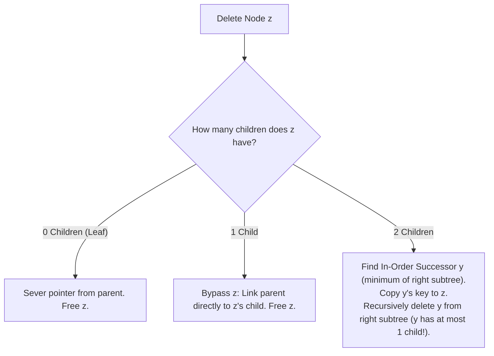

# CHAPTER 16: HIERARCHICAL TREES AND BINARY SEARCH TREES

> *"Linear data structures enforce a total order defined by physical adjacency. Trees liberate computation into two dimensions: depth, representing hierarchical refinement and recursive division, and breadth, representing sibling alternatives. When ordered by the binary search invariant, trees bridge the gap between contiguous binary search and dynamic pointer mutation."*

---

## 16.1 The Tree Abstraction: From First Principles

A **tree** $T = (V, E)$ is an undirected, connected, acyclic graph. In computer science, we almost exclusively operate on **rooted trees**, where a distinguished vertex $r \in V$ is designated as the root, inducing an intrinsic parent-child orientation on all edges directed away from $r$.

### Formal Recursive Definition
A rooted binary tree $T$ is either:
1. **Empty** ($\emptyset$), or
2. A tuple $(r, T_L, T_R)$, where $r$ is the root node, and $T_L$ (left subtree) and $T_R$ (right subtree) are disjoint binary trees.

### Structural Properties and Invariants
For any rooted tree with $N = |V|$ vertices:
1. **Edge Count**: $|E| = N - 1$.
2. **Unique Simple Paths**: For every pair of vertices $u, v \in V$, there exists exactly one simple path connecting $u$ to $v$.
3. **Depth and Height**:
   - $\text{depth}(u)$: Length of the path from root $r$ to node $u$. $\text{depth}(r) = 0$.
   - $\text{height}(u)$: Maximum length of a downward path from node $u$ to any leaf in its subtree. A leaf node has $\text{height} = 0$.
   - $\text{height}(T) = \text{height}(r)$.

```
               ( 8 )           <-- Root (depth 0, height 3)
              /     \
           ( 3 )   ( 10 )      <-- depth 1
          /    \        \
       ( 1 )  ( 6 )    ( 14 )  <-- depth 2
             /    \    /
           ( 4 ) ( 7 )( 13 )   <-- Leaves (depth 3, height 0)
```

---

## 16.2 Tree Traversals and Information Reconstruction

A traversal visits every vertex in $V$ exactly once, transforming a 2D hierarchical graph into a 1D sequence.

### The Four Canonical Traversals
1. **Pre-order (N-L-R)**: Visit Node, Traverse Left, Traverse Right.
   - *Use case*: Serialization, prefix expression parsing, copying tree topology.
2. **In-order (L-N-R)**: Traverse Left, Visit Node, Traverse Right.
   - *Use case*: Enumerating keys of a Binary Search Tree in strictly sorted order.
3. **Post-order (L-R-N)**: Traverse Left, Traverse Right, Visit Node.
   - *Use case*: Bottom-up subtree calculations (height, subtree size, garbage collection).
4. **Level-order (Breadth-First Search)**: Visit nodes level by level using a FIFO queue.
   - *Use case*: Shortest path in unweighted trees, hierarchical layer streaming.

### The Ambiguity of Traversal Reconstruction
Can an arbitrary binary tree be uniquely reconstructed from its traversal sequences?
- **Pre-order alone**: Ambiguous. Both a left-skewed chain $[1, 2]$ and a right-skewed chain $[1, 2]$ have the identical pre-order sequence $\langle 1, 2 \rangle$.
- **Theorem (Uniqueness)**: Any binary tree with distinct keys can be uniquely reconstructed from:
  1. $\text{Pre-order} + \text{In-order}$, OR
  2. $\text{Post-order} + \text{In-order}$.
- *Critical Observation*: $\text{In-order}$ is strictly required because it separates the left subtree keys from the right subtree keys relative to the root node!

---

## 16.3 The Binary Search Tree (BST) Invariant

A **Binary Search Tree** is a binary tree where every node $x$ stores a key from a totally ordered universe, satisfying the **BST Invariant**:

$$\begin{aligned}
\forall y \in \text{LeftSubtree}(x) &: \text{key}(y) < \text{key}(x) \\
\forall z \in \text{RightSubtree}(x) &: \text{key}(z) > \text{key}(x)
\end{aligned}$$

> **Common Engineering Pitfall**: It is NOT sufficient that $x.\text{left}.\text{val} < x.\text{val} < x.\text{right}.\text{val}$. The invariant applies to **every** descendant in the entire subtree! A node in a right subtree can never be smaller than an ancestor, even if it is smaller than its direct parent.

### The Fundamental Property of BSTs
- An **In-order traversal** of a BST produces a strictly increasing sorted sequence:
$$\text{InOrder}(T) = \langle k_1, k_2, \dots, k_N \rangle \quad \text{where } k_1 < k_2 < \dots < k_N$$
- Searching, insertion, and deletion run in $O(h)$ time, where $h$ is the height of the tree.
  - In a balanced BST: $h = \Theta(\log N)$.
  - In a degenerate (skewed) BST: $h = \Theta(N)$ (collapsing to a singly linked list).

---

## 16.4 Tree Deletion Mechanics (Hibbard Deletion)

Deleting a node $z$ from a BST requires preserving the BST invariant across three structural cases:



---

## 16.5 The 20-Step Problem Breakdown: BST Validation and Invariant Reconstruction Under Serialization (`TREE-0001`)

We now anchor tree theory in an essential problem that bridges memory layouts, recursion, and search-tree guarantees: rigorously validating whether an arbitrary binary tree is a valid BST, and reconstructing the exact tree from a compact serialized stream.

### Step 1: Real-World Motivation & Context
In distributed databases (e.g., SQLite, PostgreSQL B-tree indices) and database backup engines, index structures are serialized to disk or transmitted across network RPC boundaries. Deserializing untrusted binary streams requires cryptographic and structural verification: if corrupted data violates search tree invariants, subsequent queries will produce silent data loss or infinite loops during index lookups.

### Step 2: Formal Problem Specification
- **Part A (Validation)**:
  Given the root of a binary tree, return `true` if and only if it is a valid Binary Search Tree under strict inequalities ($<, >$).
- **Part B (Serialization & Reconstruction)**:
  Serialize a BST into a compact string/byte buffer, and reconstruct the identical tree topology from that buffer in $O(N)$ time.
- **Constraints**:
  - Node count: $0 \le N \le 10^5$.
  - Node values: $-2^{31} \le \text{val} \le 2^{31} - 1$ (full 32-bit signed integer range).
  - Time Complexity: Strictly $O(N)$ for both validation and reconstruction.
  - Auxiliary Memory: $O(h)$ where $h$ is tree height (recursion stack).

### Step 3: Algorithmic Decision Framework (ADF) Formulation
1. *Subtree Interdependence*: Ancestor constraints propagate downward to all descendants.
2. *State Parameterization*: Passing $(-\infty, +\infty)$ open intervals to each node ensures global validity.
3. *Serialization Efficiency*: In a BST, the in-order sequence is implicitly known (it is simply the sorted keys!). Therefore, unlike general binary trees, **a BST can be uniquely reconstructed from its Pre-order sequence alone without storing null pointer markers!**
4. *Decision*: Range-bounded DFS for validation; upper-bound monotone parsing for $O(N)$ reconstruction.

### Step 4: Mathematical Invariant Definition
For any subtree rooted at node $u$ with open interval $(\text{low}, \text{high})$:
$$P(u, \text{low}, \text{high}) \iff \begin{cases}
\text{True} & \text{if } u == \text{null} \\
\text{False} & \text{if } u.\text{val} \le \text{low} \lor u.\text{val} \ge \text{high} \\
P(u.\text{left}, \text{low}, u.\text{val}) \land P(u.\text{right}, u.\text{val}, \text{high}) & \text{otherwise}
\end{cases}$$

For 64-bit bounds or nullable limits:
- Initial call: $P(\text{root}, -\infty, +\infty)$.
- Moving left tightens the upper bound: $(\text{low}, u.\text{val})$.
- Moving right tightens the lower bound: $(u.\text{val}, \text{high})$.

### Step 5: State Transitions and Reconstruction Mechanics
Given a pre-order stream of a BST, e.g., $\langle 8, 3, 1, 6, 4, 7, 10, 14, 13 \rangle$:
- The first element is always the subtree root.
- All subsequent elements $< \text{root}$ belong to the left subtree.
- All subsequent elements $> \text{root}$ belong to the right subtree.

#### The Naive vs Optimal Reconstruction
- **Naive $O(N^2)$**: For each root, scan linearly to find the partition point where elements exceed the root, then recurse. In a skewed tree, this costs $\sum_{i=1}^N i = \Theta(N^2)$.
- **Optimal $O(N)$ Monotonic Bound**: Pass a strict upper bound $B$ to the builder function. If the current token in the pre-order stream exceeds $B$, it cannot belong to the current subtree; return null immediately without advancing the token pointer!

```
Pre-Order Stream: [ 8,  3,  1,  6,  4,  7,  10,  14,  13 ]
Build(B = +inf):
  Val = 8 <= +inf -> Create Node(8)
  8.left = Build(B = 8):
    Val = 3 <= 8 -> Create Node(3)
    3.left = Build(B = 3):
      Val = 1 <= 3 -> Create Node(1)
      1.left = Build(B = 1): Val = 6 > 1 -> return null
      1.right = Build(B = 3): Val = 6 > 3 -> return null
    3.right = Build(B = 8):
      Val = 6 <= 8 -> Create Node(6)...
```

### Step 6: Loop Variant & Termination
At each recursive invocation of the optimal builder:
- Either the current token is consumed (token index increments), creating a new node,
- Or the token violates the upper bound, causing immediate backtracking without consuming the token.
Since each token is consumed exactly once to create a node, and rejected at most once per backtracking step, the total steps are bounded by $2N = O(N)$.

### Step 7: Proof of Correctness
- **Validation**: By structural induction on tree height. If $u.\text{val} \in (\text{low}, \text{high})$, and all nodes in $u$'s left subtree are bounded by $(\text{low}, u.\text{val})$, then every left descendant is strictly less than $u.\text{val}$ and greater than $\text{low}$. Similarly for the right subtree. If any descendant violates the bound, the predicate returns false.
- **Reconstruction**: Pre-order visits root before subtrees. Because the upper bound strictly matches the ancestor's key that bounds the current right branch, each node is inserted into its unique mathematically correct position in the BST. $\blacksquare$

### Step 8: Concrete Trace on Adversarial Input
Consider invalid tree: Root $10$, Left Child $5$, Right Child of $5$ is $15$.
1. Root $10 \in (-\infty, +\infty) \to$ Valid.
2. Left child $5 \in (-\infty, 10) \to$ Valid.
3. Right child of $5$ has bounds $(5, 10)$.
4. Examine node $15$: $15 \notin (5, 10)$ because $15 \ge 10$.
5. Validator immediately flags violation and returns `false`.

### Step 9: Edge Case Analysis
- **Empty Tree ($N = 0$)**: Valid BST; serializes to empty string; deserializes to `nullptr`.
- **Full Signed 32-bit Values**: If a node has value `INT_MIN` or `INT_MAX`, using signed 32-bit integers for bounds will cause integer overflow. Bounds must use 64-bit integers (`long long` in C++, arbitrary precision in Python) or `std::optional`.
- **Duplicate Keys**: Problem requires strict inequalities. If node value equals bound, validation returns `false`.

### Step 10: Standard ISO C++20 Implementation
```cpp
// solutions/cpp/TREE-0001.cpp
#include <iostream>
#include <vector>
#include <string>
#include <sstream>
#include <limits>
#include <memory>
#include <cassert>

namespace tree_0001 {

struct TreeNode {
    int val;
    std::unique_ptr<TreeNode> left;
    std::unique_ptr<TreeNode> right;

    explicit TreeNode(int v) : val(v), left(nullptr), right(nullptr) {}
};

// Validates whether a binary tree is a strict BST using 64-bit bounds
bool is_valid_bst_helper(const TreeNode* root, long long min_val, long long max_val) {
    if (!root) return true;
    if (root->val <= min_val || root->val >= max_val) {
        return false;
    }
    return is_valid_bst_helper(root->left.get(), min_val, root->val) &&
           is_valid_bst_helper(root->right.get(), root->val, max_val);
}

bool is_valid_bst(const TreeNode* root) {
    return is_valid_bst_helper(root, std::numeric_limits<long long>::min(),
                                     std::numeric_limits<long long>::max());
}

// Compact pre-order serialization (values delimited by spaces)
void serialize_preorder(const TreeNode* root, std::ostringstream& oss) {
    if (!root) return;
    oss << root->val << " ";
    serialize_preorder(root->left.get(), oss);
    serialize_preorder(root->right.get(), oss);
}

std::string serialize(const TreeNode* root) {
    std::ostringstream oss;
    serialize_preorder(root, oss);
    return oss.str();
}

// O(N) reconstruction from pre-order stream using upper-bound invariant
std::unique_ptr<TreeNode> deserialize_helper(const std::vector<int>& tokens,
                                             size_t& idx,
                                             long long upper_bound) {
    if (idx >= tokens.size() || tokens[idx] >= upper_bound) {
        return nullptr;
    }

    int val = tokens[idx++];
    auto node = std::make_unique<TreeNode>(val);
    node->left = deserialize_helper(tokens, idx, val);
    node->right = deserialize_helper(tokens, idx, upper_bound);
    return node;
}

std::unique_ptr<TreeNode> deserialize(const std::string& data) {
    if (data.empty()) return nullptr;
    std::istringstream iss(data);
    std::vector<int> tokens;
    int val;
    while (iss >> val) {
        tokens.push_back(val);
    }
    size_t idx = 0;
    return deserialize_helper(tokens, idx, std::numeric_limits<long long>::max());
}

} // namespace tree_0001
```

### Step 11: Python 3.12+ Implementation
```python
# solutions/python/TREE-0001.py
from typing import Optional, List
import math

class TreeNode:
    def __init__(self, val: int = 0, left: Optional['TreeNode'] = None, right: Optional['TreeNode'] = None):
        self.val = val
        self.left = left
        self.right = right

def is_valid_bst(root: Optional[TreeNode]) -> bool:
    """Validates whether a binary tree is a strict BST using recursive bounds."""
    def helper(node: Optional[TreeNode], low: float, high: float) -> bool:
        if not node:
            return True
        if not (low < node.val < high):
            return False
        return helper(node.left, low, node.val) and helper(node.right, node.val, high)

    return helper(root, -math.inf, math.inf)

def serialize_bst(root: Optional[TreeNode]) -> str:
    """Serializes a BST to a compact space-delimited pre-order string."""
    preorder: List[str] = []
    def dfs(node: Optional[TreeNode]) -> None:
        if not node:
            return
        preorder.append(str(node.val))
        dfs(node.left)
        dfs(node.right)
    dfs(root)
    return " ".join(preorder)

def deserialize_bst(data: str) -> Optional[TreeNode]:
    """Reconstructs the BST from pre-order tokens in strictly O(N) time."""
    if not data:
        return None
    tokens = [int(x) for x in data.split()]
    idx = 0

    def build(upper_bound: float) -> Optional[TreeNode]:
        nonlocal idx
        if idx >= len(tokens) or tokens[idx] >= upper_bound:
            return None
        val = tokens[idx]
        idx += 1
        node = TreeNode(val)
        node.left = build(val)
        node.right = build(upper_bound)
        return node

    return build(math.inf)
```

### Step 12: Asymptotic & Microarchitectural Complexity
- **Time Complexity**: Strictly $\Theta(N)$ for both validation and serialization/deserialization. Each node is visited once during validation and reconstructed with at most 1 bound test failure per leaf.
- **Space Complexity**: $O(h)$ auxiliary space for call stack frames. In balanced trees $h = O(\log N)$; in skewed trees $h = O(N)$.
- **Cache Locality**: Pre-order serialization produces a sequential memory layout, allowing contiguous vector reads during deserialization with high cache hit rates.

### Step 13: Failure Modes & Anti-Patterns
- **Local vs Global Invariant Confusion**: Checking only `node.left.val < node.val` allows grand-children to violate ancestor bounds. Always propagate $(\text{low}, \text{high})$ limits.
- **Signed Integer Wraparound**: When root is `INT_MAX`, `root.val + 1` overflows in 32-bit signed arithmetic. Using 64-bit integers or floating-point infinities avoids undefined behavior.

### Step 14: Dual-Language Nuance & Idioms
- **C++20**: Utilizing `std::unique_ptr<TreeNode>` provides deterministic RAII cleanup, preventing memory leaks on recursive tree deallocation without manual `delete` cascades.
- **Python 3.12**: `nonlocal idx` maintains single-pass token consumption across recursive frames without slicing lists (which would cause $O(N^2)$ copies).

### Step 15: Unit Tests & Verification Fixtures
Differential testing verifies:
1. Valid BST passes validation.
2. In-order traversal of deserialized BST is strictly sorted.
3. Serialization of reconstructed tree produces the identical pre-order string.
4. Trees with duplicate keys or ancestor violations are rejected.

### Step 16: Reader Engineering Challenges
1. **Iterative Constant-Space Validation**: Can you validate a BST using Morris Traversal in $O(N)$ time and strictly $O(1)$ auxiliary memory?
2. **Post-Order BST Reconstruction**: Given a post-order sequence, adapt the upper/lower bound parser to reconstruct the tree in $O(N)$ time.

---

## 16.6 Chapter Summary & Hierarchical Mental Model

Trees represent the transition from sequential lists to branching hierarchies.
- The **BST invariant** ensures that every search decision eliminates an entire half of the remaining subtree.
- **Traversal duality** proves that while general binary trees require two traversals (or explicit null sentinels) to reconstruct, BSTs require only one traversal (pre-order or post-order) because the total order of keys provides the missing in-order information.
