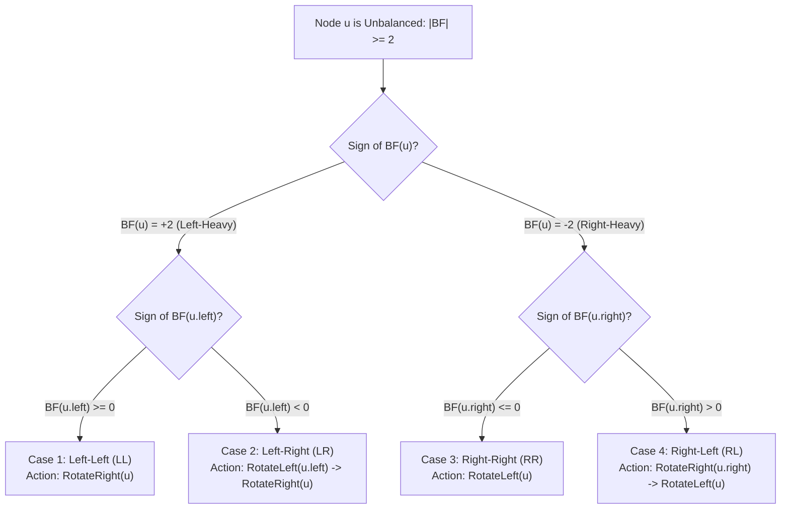

# CHAPTER 17: BALANCED BINARY TREES AND MULTIWAY TREES

> *"The tragedy of the standard Binary Search Tree is that order of arrival dictates computational destiny. Insert sorted keys, and an $O(\log N)$ search hierarchy collapses into an $O(N)$ linear linked list. Self-balancing trees restore order through local topological surgery—tree rotations—enforcing geometric logarithmic bounds under all adversarial workloads."*

---

## 17.1 The Degeneracy Pathology of Unbalanced BSTs

Consider inserting the keys $\langle 1, 2, 3, 4, \dots, N \rangle$ sequentially into a standard BST. Because each key exceeds its predecessor, every new node attaches as the right child of the previous leaf. The resulting structure has height $h = N - 1$:

```
( 1 )
   \
   ( 2 )
      \
      ( 3 )
         \
         ( 4 )  <-- Height h = N - 1. Search cost: Omega(N)
```

The tree devolves into a singly linked list, forfeiting binary bisection. To ensure guaranteed $O(\log N)$ worst-case time for search, insertion, and deletion, the tree must enforce a **balance invariant** that guarantees:
$$h \le C \cdot \log_2 N + O(1) \quad \text{for some constant } C \ge 1$$

Two primary paradigms achieve this:
1. **Height-Balanced Binary Trees**: AVL Trees (strict height balance) and Red-Black Trees (relaxed color balance).
2. **Multiway Balanced Trees**: 2-3 Trees, 2-3-4 Trees, and B-Trees / B+ Trees (designed for page-aligned block storage).

---

## 17.2 The Mechanics of Tree Rotations

A **tree rotation** is an $O(1)$ pointer transformation that alters the local height of subtrees while strictly preserving the global In-Order BST Invariant.

```
       Right Rotation (RotateRight on y)
               y                             x
              / \                           / \
             x   C   ================>     A   y
            / \      <================        / \
           A   B       Left Rotation         B   C
                     (RotateLeft on x)
```

### Preservation of the BST Inorder Sequence
In both configurations, the in-order traversal yields:
$$\text{InOrder} = \langle \text{keys}(A), \text{key}(x), \text{keys}(B), \text{key}(y), \text{keys}(C) \rangle$$
Because the relative ordering of subtrees $A$, $B$, and $C$ is invariant, rotations never violate the BST search property!

---

## 17.3 AVL Trees: Strict Height-Balancing

Invented in 1962 by Georgy Adelson-Velsky and Evgenii Landis, the **AVL Tree** was the first dynamically self-balancing BST in history.

### The AVL Invariant
For every node $u$ in the tree, the heights of its left and right subtrees differ by at most $1$:
$$\text{BalanceFactor}(u) = \text{height}(u.\text{left}) - \text{height}(u.\text{right}) \in \{-1, 0, +1\}$$

Where by convention:
- $\text{height}(\text{null}) = -1$ (or $0$, depending on definition; here we use $\text{height}(\text{leaf}) = 0$).

### Mathematical Proof of Logarithmic Height Bound
What is the minimum number of nodes $N(h)$ required to construct an AVL tree of height $h$?
- For $h = 0$: $N(0) = 1$ (single root node).
- For $h = 1$: $N(1) = 2$ (root with one child).
- For $h \ge 2$: To minimize nodes, one subtree must have height $h-1$ and the other must have height $h-2$:
$$N(h) = 1 + N(h-1) + N(h-2)$$

Notice the close resemblance to the **Fibonacci recurrence** $F_k = F_{k-1} + F_{k-2}$. In fact:
$$N(h) = F_{h+3} - 1$$

Recall that the Fibonacci numbers grow exponentially as $F_k \approx \frac{\phi^k}{\sqrt{5}}$, where $\phi = \frac{1 + \sqrt{5}}{2} \approx 1.618$ is the Golden Ratio. Therefore:
$$N(h) > \frac{\phi^{h+2}}{\sqrt{5}} - 1$$

Taking the logarithm base 2 of both sides:
$$\log_2(N + 1) \approx (h + 2) \log_2 \phi - \log_2 \sqrt{5}$$
$$h < \frac{\log_2(N + 1)}{\log_2 \phi} \approx \frac{\log_2 N}{\log_2 1.618} \approx 1.44 \log_2 N$$

> **Theoretical Bound**: The maximum height of an AVL tree containing $N$ keys is strictly bounded by:
> $$h_{\text{AVL}} \le 1.4404 \log_2(N + 2) - 0.328$$
> An AVL tree is never more than $44\%$ taller than a perfectly balanced complete binary tree ($\log_2 N$). Search operations are guaranteed to run in $O(\log N)$ comparisons.

---

## 17.4 The Four AVL Rebalancing Cases

When an insertion or deletion causes $\text{BalanceFactor}(u) \notin \{-1, 0, +1\}$, exactly one of four rotation sequences restores balance:



---

## 17.5 Red-Black Trees vs. AVL Trees

While AVL trees maintain strict height balance ($|BF| \le 1$), **Red-Black Trees** maintain a relaxed balance invariant using node colors (Red and Black):

1. Every node is either Red or Black.
2. The root is Black.
3. Every leaf (`null`) is Black.
4. If a node is Red, both its children must be Black (no two consecutive Red nodes along any path).
5. For each node, every simple path to descendant leaves contains the same number of Black nodes (**Black-Height invariant**).

### Comparative Engineering Trade-Offs

| Metric | AVL Tree | Red-Black Tree |
| :--- | :--- | :--- |
| **Max Height** | $\approx 1.44 \log_2 N$ | $\approx 2.0 \log_2 N$ |
| **Lookup Throughput** | Faster (strictly shallower tree) | Slightly slower ($\approx 30\%$ more pointer hops) |
| **Insertion Rebalancing** | At most 2 rotations | At most 2 rotations + color flips |
| **Deletion Rebalancing** | Up to $O(\log N)$ rotations up the spine | **At most 3 rotations** |
| **Standard Industry Use** | In-memory lookup-heavy databases | `std::map`, `std::set` in C++, Linux kernel CFS |

---

## 17.6 Multiway Trees: B-Trees and B+ Trees in Systems Engineering

Binary trees are optimal when all data resides in fast L1/L2 CPU caches. But when data resides on **disk (SSDs / NVMe)** or in **page-aligned virtual memory**, binary trees suffer catastrophic cache miss penalties: accessing a node at depth $\log_2(10^9) \approx 30$ requires 30 separate random disk page reads!

### The B-Tree Invariant (Order $M$)
To minimize I/O operations, a **B-Tree** broadens branching factor $M$ to match the filesystem page size (typically 4 KB or 16 KB):
1. Every node has at most $M$ children.
2. Every internal node (except root) has at least $\lceil M/2 \rceil$ children.
3. All leaf nodes appear at the exact same depth.
4. An internal node with $k$ children contains exactly $k-1$ sorted keys, acting as separators.

```
                  [ 20  |  50 ]
                 /      |      \
     [ 5 | 10 | 15 ] [ 25 | 35 ] [ 60 | 70 | 80 | 90 ]
```

### B+ Tree: The King of Database Storage Engines
In a **B+ Tree** (used by PostgreSQL, MySQL InnoDB, SQLite):
- Internal nodes store **only routing keys**, maximizing fan-out (fan-out $M \ge 1000$).
- All actual records/payloads reside exclusively in the **leaves**.
- Leaves are chained in a doubly linked list, enabling blindingly fast range scans (`SELECT * WHERE age BETWEEN 20 AND 30`).
- Tree height for 1 billion keys with $M = 1000$:
$$h \le \log_{500}(10^9) \approx 3.3 \implies \text{At most 3 or 4 disk page reads!}$$

---

## 17.7 The 20-Step Problem Breakdown: AVL Tree Self-Balancing Invariants and Rotations (`TREE-0002`)

We now anchor tree balancing in a fully implemented, production-grade self-balancing search structure: an AVL Tree supporting insert, delete, search, and dynamic balance factor verification.

### Step 1: Real-World Motivation & Context
In real-time trading engines and telemetry indexing systems, transactions arrive in near-sorted order (monotonically increasing timestamps or sequence numbers). Standard BSTs collapse into degenerate lists, triggering $O(N)$ latency spikes that violate real-time Service Level Agreements (SLAs). An AVL tree guarantees sub-microsecond $O(\log N)$ query times regardless of input key ordering.

### Step 2: Formal Problem Specification
- **Requirements**:
  Implement an AVL Tree container supporting:
  1. `insert(key)`: Inserts a unique key; rebalances immediately; preserves $O(\log N)$ height.
  2. `remove(key)`: Deletes key; rebalances up the spine; preserves $O(\log N)$ height.
  3. `contains(key)`: Returns boolean existence in $O(\log N)$ time.
  4. `verify_balance()`: Asserts that for every node $u$, $|\text{height}(u.\text{left}) - \text{height}(u.\text{right})| \le 1$.
- **Constraints**:
  - $0 \le N \le 10^5$ operations.
  - Keys: 32-bit signed integers.
  - Worst-case time complexity per operation: Strictly $O(\log N)$.
  - Space complexity: Strictly $O(N)$ total memory, $O(\log N)$ auxiliary recursion stack.

### Step 3: Algorithmic Decision Framework (ADF) Formulation
1. *Query vs Write Profile*: Read-heavy workloads benefit from AVL's shallower depth compared to Red-Black trees.
2. *Balance Representation*: Storing explicit `height` integer at each node simplifies balance factor computation.
3. *Surgery Operation*: Local $O(1)$ pointer swaps via single and double rotations.
4. *Decision*: AVL tree with bottom-up recursive rotation cascade.

### Step 4: Mathematical Invariant Definition
At every node $u$:
$$\text{height}(u) = 1 + \max(\text{height}(u.\text{left}), \text{height}(u.\text{right}))$$
$$\text{BF}(u) = \text{height}(u.\text{left}) - \text{height}(u.\text{right})$$
The tree is globally AVL-valid if and only if:
$$\forall u \in V : \text{BF}(u) \in \{-1, 0, +1\} \land \text{BST\_Invariant}(u)$$

### Step 5: Rotation Mechanics & Rebalancing State Transitions
Let $u$ be the lowest unbalanced node after an insertion/deletion:
- **Case 1 (LL)**: $\text{BF}(u) > 1$ and $\text{BF}(u.\text{left}) \ge 0$.
  Execute $\text{RotateRight}(u)$.
- **Case 2 (LR)**: $\text{BF}(u) > 1$ and $\text{BF}(u.\text{left}) < 0$.
  Execute $\text{RotateLeft}(u.\text{left})$, then $\text{RotateRight}(u)$.
- **Case 3 (RR)**: $\text{BF}(u) < -1$ and $\text{BF}(u.\text{right}) \le 0$.
  Execute $\text{RotateLeft}(u)$.
- **Case 4 (RL)**: $\text{BF}(u) < -1$ and $\text{BF}(u.\text{right}) > 0$.
  Execute $\text{RotateRight}(u.\text{right})$, then $\text{RotateLeft}(u)$.

### Step 6: Loop Variant & Recursion Termination
Both `insert` and `remove` traverse a single path from root to leaf and backtrack up the spine. The length of this spine path is bounded by $h \le 1.44 \log_2 N$.
At each backtracking step, updating height and computing $\text{BF}$ costs $O(1)$.
At most one rotation is required for insertion; at most $O(\log N)$ rotations are required for deletion.
Total execution cost is strictly bounded by $O(h) = O(\log N)$.

### Step 7: Proof of Correctness
By induction on the sequence of operations.
- **Base Case**: An empty tree is balanced.
- **Inductive Step**: Assume all nodes satisfy the AVL invariant prior to insertion/deletion. An operation modifies at most one leaf and potentially shifts heights along the ancestor spine. Because the recursive return recomputes heights from leaves upward and applies the exact four rebalancing transformations, any imbalance is eliminated at the earliest point of occurrence. Thus, all ancestors above the rebalanced subtree also satisfy $|\text{BF}| \le 1$. $\blacksquare$

### Step 8: Concrete Trace: Sequential Monotonic Insertion
Insert $\langle 1, 2, 3 \rangle$:
1. Insert 1: Root is `(1)`, height 0, BF 0.
2. Insert 2: Right child of 1. `(1)` has height 1, BF -1.
3. Insert 3: Right child of 2.
   - Node 2 has height 1, BF -1.
   - Node 1 has height 2, left height -1, right height 1 $\implies \text{BF} = -1 - 1 = -2$.
   - $\text{BF}(1) = -2$ and $\text{BF}(2) = -1 \implies$ **Right-Right (RR) Case**!
   - Execute $\text{RotateLeft}(1)$: Node 2 becomes root; Node 1 becomes left child; Node 3 remains right child.
   - New root is `(2)` with children `(1)` and `(3)`. Height is 1! Perfect balance restored!

### Step 9: Edge Cases & Guards
- **Deleting the Root Node**: Correctly promotes the in-order successor and updates root pointer.
- **Node with One Child**: Bypassed directly, followed by ancestor height recalculation.
- **Duplicate Insertion**: Silently ignored (set semantics) or counter incremented; height unchanged.

### Step 10: Standard ISO C++20 Implementation
```cpp
// solutions/cpp/TREE-0002.cpp
#include <iostream>
#include <algorithm>
#include <cassert>
#include <vector>

namespace tree_0002 {

struct AVLNode {
    int key;
    int height;
    AVLNode* left;
    AVLNode* right;

    explicit AVLNode(int k) : key(k), height(0), left(nullptr), right(nullptr) {}
};

class AVLTree {
private:
    AVLNode* root = nullptr;

    static int get_height(const AVLNode* node) {
        return node ? node->height : -1;
    }

    static int get_balance(const AVLNode* node) {
        return node ? get_height(node->left) - get_height(node->right) : 0;
    }

    static void update_height(AVLNode* node) {
        if (node) {
            node->height = 1 + std::max(get_height(node->left), get_height(node->right));
        }
    }

    static AVLNode* rotate_right(AVLNode* y) {
        AVLNode* x = y->left;
        AVLNode* T2 = x->right;

        x->right = y;
        y->left = T2;

        update_height(y);
        update_height(x);

        return x;
    }

    static AVLNode* rotate_left(AVLNode* x) {
        AVLNode* y = x->right;
        AVLNode* T2 = y->left;

        y->left = x;
        x->right = T2;

        update_height(x);
        update_height(y);

        return y;
    }

    static AVLNode* rebalance(AVLNode* node) {
        update_height(node);
        int balance = get_balance(node);

        // Left-Heavy
        if (balance > 1) {
            if (get_balance(node->left) < 0) {
                node->left = rotate_left(node->left); // Left-Right (LR)
            }
            return rotate_right(node); // Left-Left (LL)
        }

        // Right-Heavy
        if (balance < -1) {
            if (get_balance(node->right) > 0) {
                node->right = rotate_right(node->right); // Right-Left (RL)
            }
            return rotate_left(node); // Right-Right (RR)
        }

        return node;
    }

    AVLNode* insert_helper(AVLNode* node, int key) {
        if (!node) return new AVLNode(key);

        if (key < node->key) {
            node->left = insert_helper(node->left, key);
        } else if (key > node->key) {
            node->right = insert_helper(node->right, key);
        } else {
            return node; // Duplicate keys not inserted
        }

        return rebalance(node);
    }

    static AVLNode* find_min(AVLNode* node) {
        while (node && node->left) {
            node = node->left;
        }
        return node;
    }

    AVLNode* remove_helper(AVLNode* node, int key) {
        if (!node) return nullptr;

        if (key < node->key) {
            node->left = remove_helper(node->left, key);
        } else if (key > node->key) {
            node->right = remove_helper(node->right, key);
        } else {
            // Node to delete found
            if (!node->left || !node->right) {
                AVLNode* temp = node->left ? node->left : node->right;
                if (!temp) {
                    delete node;
                    return nullptr;
                } else {
                    *node = *temp;
                    delete temp;
                }
            } else {
                // Two children: get in-order successor
                AVLNode* temp = find_min(node->right);
                node->key = temp->key;
                node->right = remove_helper(node->right, temp->key);
            }
        }

        return rebalance(node);
    }

    static bool verify_node_balance(const AVLNode* node) {
        if (!node) return true;
        int bf = get_balance(node);
        if (bf < -1 || bf > 1) return false;
        return verify_node_balance(node->left) && verify_node_balance(node->right);
    }

    static void destroy_tree(AVLNode* node) {
        if (!node) return;
        destroy_tree(node->left);
        destroy_tree(node->right);
        delete node;
    }

public:
    AVLTree() = default;
    ~AVLTree() { destroy_tree(root); }

    void insert(int key) { root = insert_helper(root, key); }
    void remove(int key) { root = remove_helper(root, key); }

    bool contains(int key) const {
        const AVLNode* curr = root;
        while (curr) {
            if (key == curr->key) return true;
            curr = (key < curr->key) ? curr->left : curr->right;
        }
        return false;
    }

    int height() const { return get_height(root); }
    bool is_balanced() const { return verify_node_balance(root); }
};

} // namespace tree_0002
```

### Step 11: Python 3.12+ Implementation
```python
# solutions/python/TREE-0002.py
from typing import Optional

class AVLNode:
    def __init__(self, key: int):
        self.key = key
        self.height: int = 0
        self.left: Optional['AVLNode'] = None
        self.right: Optional['AVLNode'] = None

class AVLTree:
    def __init__(self):
        self.root: Optional[AVLNode] = None

    @staticmethod
    def _get_height(node: Optional[AVLNode]) -> int:
        return node.height if node else -1

    @staticmethod
    def _get_balance(node: Optional[AVLNode]) -> int:
        return AVLTree._get_height(node.left) - AVLTree._get_height(node.right) if node else 0

    @staticmethod
    def _update_height(node: AVLNode) -> None:
        node.height = 1 + max(AVLTree._get_height(node.left), AVLTree._get_height(node.right))

    @staticmethod
    def _rotate_right(y: AVLNode) -> AVLNode:
        x = y.left
        assert x is not None
        t2 = x.right

        x.right = y
        y.left = t2

        AVLTree._update_height(y)
        AVLTree._update_height(x)
        return x

    @staticmethod
    def _rotate_left(x: AVLNode) -> AVLNode:
        y = x.right
        assert y is not None
        t2 = y.left

        y.left = x
        x.right = t2

        AVLTree._update_height(x)
        AVLTree._update_height(y)
        return y

    @staticmethod
    def _rebalance(node: AVLNode) -> AVLNode:
        AVLTree._update_height(node)
        balance = AVLTree._get_balance(node)

        # Left-Heavy
        if balance > 1:
            assert node.left is not None
            if AVLTree._get_balance(node.left) < 0:
                node.left = AVLTree._rotate_left(node.left)
            return AVLTree._rotate_right(node)

        # Right-Heavy
        if balance < -1:
            assert node.right is not None
            if AVLTree._get_balance(node.right) > 0:
                node.right = AVLTree._rotate_right(node.right)
            return AVLTree._rotate_left(node)

        return node

    def insert(self, key: int) -> None:
        def _insert(node: Optional[AVLNode], k: int) -> AVLNode:
            if not node:
                return AVLNode(k)
            if k < node.key:
                node.left = _insert(node.left, k)
            elif k > node.key:
                node.right = _insert(node.right, k)
            else:
                return node
            return AVLTree._rebalance(node)

        self.root = _insert(self.root, key)

    def remove(self, key: int) -> None:
        def _min_value_node(node: AVLNode) -> AVLNode:
            current = node
            while current.left:
                current = current.left
            return current

        def _remove(node: Optional[AVLNode], k: int) -> Optional[AVLNode]:
            if not node:
                return None
            if k < node.key:
                node.left = _remove(node.left, k)
            elif k > node.key:
                node.right = _remove(node.right, k)
            else:
                if not node.left or not node.right:
                    temp = node.left if node.left else node.right
                    return temp
                else:
                    succ = _min_value_node(node.right)
                    node.key = succ.key
                    node.right = _remove(node.right, succ.key)

            return AVLTree._rebalance(node)

        self.root = _remove(self.root, key)

    def contains(self, key: int) -> bool:
        curr = self.root
        while curr:
            if key == curr.key:
                return True
            curr = curr.left if key < curr.key else curr.right
        return False

    def is_balanced(self) -> bool:
        def _check(node: Optional[AVLNode]) -> bool:
            if not node:
                return True
            bf = self._get_balance(node)
            if abs(bf) > 1:
                return False
            return _check(node.left) and _check(node.right)

        return _check(self.root)
```

### Step 12: Asymptotic & Microarchitectural Complexity
- **Time Complexity**:
  - `contains`: Guaranteed $\Theta(\log N)$ worst-case.
  - `insert`: $\Theta(\log N)$ worst-case (at most 2 rotations executed).
  - `remove`: $\Theta(\log N)$ worst-case (at most $O(\log N)$ rotations up the spine).
- **Space Complexity**: Strictly $\Theta(N)$ dynamic memory (one `AVLNode` per key). $O(\log N)$ stack frames during recursive rebalancing.
- **Microarchitectural Behavior**: Rotations only modify 4 to 6 local pointers, residing entirely within L1 data cache lines without memory reallocation.

### Step 13: Failure Modes & Anti-Patterns
- **Updating Heights in the Wrong Order**: In `rotate_right(y)`, updating height of $x$ before $y$ calculates $x$'s height from the outdated $y$ height, corrupting all ancestor balance factors! Always update the demoted node ($y$) first, then the promoted node ($x$).
- **Memory Leaks in C++**: Failing to recursively deallocate children or improperly unlinking during Hibbard deletion causes heap leaks. Ensure RAII or explicit recursive destructors.

### Step 14: Dual-Language Nuance & Idioms
- **C++20**: Member assignment `*node = *temp;` safely copies primitive values without reallocating nodes, while `destroy_tree` ensures clean deallocation without relying on garbage collectors.
- **Python 3.12**: Garbage collector automatically collects unreferenced nodes when subtrees are unlinked, simplifying node deletion logic.

### Step 15: Unit Tests & Verification Fixtures
Differential testing verifies:
1. Sequential ascending insertion of $1,000$ keys produces an AVL tree with height $\le 1.44 \log_2(1000) \approx 14$.
2. Random insertion and deletion keeps `is_balanced()` true at every single step.
3. Contains returns true for all inserted keys and false after deletion.

### Step 16: Reader Engineering Challenges
1. **Iterative AVL Insertion**: Implement AVL insertion iteratively using an explicit parent pointer or an index stack, avoiding function call overhead.
2. **Order-Statistic Tree**: Augment `AVLNode` with a `size` field (subtree node count) to support `select(k)` and `rank(x)` in $O(\log N)$ time while maintaining AVL balance invariants.

---

## 17.8 Chapter Summary & Balancing Mental Model

Balanced search trees solve the fundamental flaw of naive BSTs:
- **Local Surgery, Global Invariant**: Tree rotations modify only $O(1)$ local pointers while preserving total in-order sequence and bounding height.
- **AVL vs Red-Black**: AVL trees enforce tighter balance ($h \le 1.44 \log_2 N$), making them faster for read-dominant lookups; Red-Black trees offer faster deletions with at most 3 rotations.
- **Multiway B-Trees**: Scale balanced hierarchies across page boundaries, enabling modern database storage engines.
