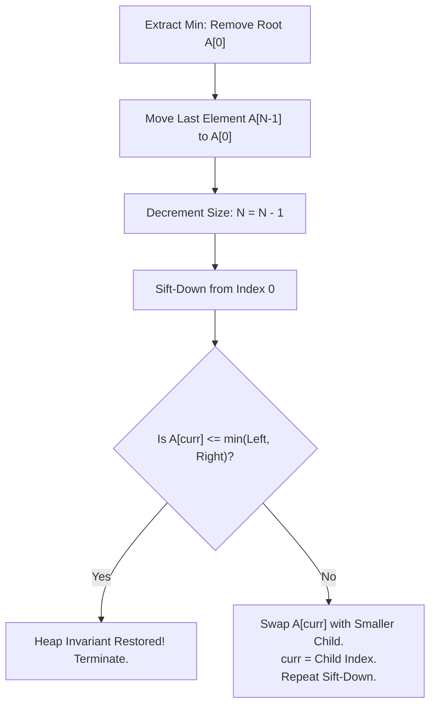

# CHAPTER 18: HEAPS AND PRIORITY SCHEDULING

> *"A totally ordered search tree pays an $O(\log N)$ fee on every key access to maintain exhaustive knowledge of all relative orders. A Priority Queue abandons total order in favor of partial order: it promises only to know who is first, deferring all other comparisons until destiny demands them. This deliberate ignorance is the secret to its blazing efficiency."*

---

## 18.1 The Priority Queue Abstract Data Type

While stacks enforce LIFO order and queues enforce FIFO order, many computational systems require scheduling elements by **importance, urgency, or timestamp**.

### The Priority Queue Interface
A priority queue maintains a dynamic multi-set of prioritized elements supporting three core operations:
1. `insert(item, priority)`: Add a new element with an associated priority key.
2. `find_min()` (or `find_max()`): Return the element with the extreme priority without removal.
3. `extract_min()` (or `extract_max()`): Remove and return the extreme element.

### Comparison with Alternative Data Structures
Why not use a sorted array or a balanced BST?

| Data Structure | `insert` | `find_min` | `extract_min` | Memory Overhead / Cache |
| :--- | :--- | :--- | :--- | :--- |
| **Unsorted Contiguous Array** | $O(1)$ | $O(N)$ | $O(N)$ | Optimal spatial locality, zero pointer overhead |
| **Sorted Contiguous Array** | $O(N)$ | $O(1)$ | $O(1)$ amortized | Costly element shifting on insertion |
| **Balanced BST (AVL/Red-Black)** | $O(\log N)$ | $O(\log N)$ | $O(\log N)$ | $3\times$ pointer overhead (left, right, parent, color/height) |
| **Binary Heap (Implicit Array)** | $O(\log N)$ | $\mathbf{O(1)}$ | $O(\log N)$ | **Zero pointer overhead**, perfectly packed contiguous array |

---

## 18.2 The Binary Heap: Invariants and Implicit Array Embedding

A **Binary Heap** is a complete binary tree that satisfies the **Heap-Order Invariant**:
- In a **Min-Heap**: For every node $i$ other than the root:
  $$\text{key}(\text{parent}(i)) \le \text{key}(i)$$
- In a **Max-Heap**: For every node $i$ other than the root:
  $$\text{key}(\text{parent}(i)) \ge \text{key}(i)$$

### The Implicit Array Representation
Because a binary heap is always a **complete binary tree** (all levels are fully populated except possibly the last, which is filled strictly from left to right), it can be mapped into a contiguous 0-indexed array with **zero pointer allocations**:

```
Logical Complete Binary Tree:
               [ 2 ] (index 0)
              /     \
         [ 5 ]       [ 3 ] (indices 1, 2)
        /     \     /
     [ 9 ]   [ 6 ] [ 8 ]   (indices 3, 4, 5)

Contiguous Physical Memory:
Index:   0    1    2    3    4    5
Array: [ 2 ][ 5 ][ 3 ][ 9 ][ 6 ][ 8 ]
```

For any node at 0-based index $i$:
$$\text{parent}(i) = \lfloor (i - 1) / 2 \rfloor$$
$$\text{left\_child}(i) = 2i + 1$$
$$\text{right\_child}(i) = 2i + 2$$

Index arithmetic compiles to single-cycle machine instructions: $2i + 1$ is simply `(i << 1) | 1`, and $\lfloor (i - 1) / 2 \rfloor$ is `(i - 1) >> 1`.

---

## 18.3 Heap Restoration Mechanics: Sift-Up and Sift-Down

Whenever an operation disturbs the heap invariant, local swaps restore order:

### Sift-Up (Percolate Up)
Used after appending a new element at index $N-1$:
- Compare the element with its parent.
- If the child is smaller than its parent (in a min-heap), swap them.
- Repeat until the parent is $\le$ child or the root is reached.
- Worst-case swaps: $\lfloor \log_2 N \rfloor = O(\log N)$.

### Sift-Down (Percolate Down)
Used after replacing the root with the last element during `extract_min`:
- Compare the current node with its children.
- Identify the **smallest** among the node and its children.
- If the smallest is a child, swap with that child and recurse downward.
- Worst-case swaps: $\lfloor \log_2 N \rfloor = O(\log N)$.



---

## 18.4 Linear-Time Heap Construction: Floyd's Algorithm

Given an unsorted array of $N$ elements, how fast can we transform it into a valid heap?
- **Naive Insertion**: Repeatedly call `insert` for all $N$ elements:
  $$\sum_{i=1}^N \log i = \log(N!) = \Theta(N \log N)$$
- **Floyd's `build_heap`**: Call `sift_down` bottom-up starting from the lowest internal node down to the root:
  $$\text{for } i = \lfloor N/2 \rfloor - 1 \text{ down to } 0: \quad \text{sift\_down}(i)$$

### Mathematical Proof of $O(N)$ Bound
Why is bottom-up `sift_down` strictly linear?
In a complete binary tree of height $h = \lfloor \log_2 N \rfloor$:
- There are at most $\lceil N / 2^{k+1} \rceil$ nodes at height $k$.
- A node at height $k$ can sift down at most $k$ levels.

The total number of swaps $S$ across all nodes is bounded by:
$$S \le \sum_{k=0}^{\lfloor \log_2 N \rfloor} \left\lceil \frac{N}{2^{k+1}} \right\rceil k \le \frac{N}{2} \sum_{k=0}^\infty \frac{k}{2^k}$$

Recall the standard geometric series identity for $\sum_{k=0}^\infty k x^k$:
$$\sum_{k=0}^\infty x^k = \frac{1}{1 - x} \implies \frac{d}{dx} \sum_{k=0}^\infty x^k = \sum_{k=0}^\infty k x^{k-1} = \frac{1}{(1 - x)^2}$$
Multiplying by $x$:
$$\sum_{k=0}^\infty k x^k = \frac{x}{(1 - x)^2}$$

Setting $x = 1/2$:
$$\sum_{k=0}^\infty \frac{k}{2^k} = \frac{1/2}{(1 - 1/2)^2} = \frac{1/2}{1/4} = 2$$

Substituting this back into the sum:
$$S \le \frac{N}{2} \times 2 = N$$

> **Theorem (Floyd's Heapify)**: Transforming an arbitrary unsorted array of size $N$ into a binary heap requires at most $N$ element swaps and at most $2N$ comparisons. The time complexity is strictly $\Theta(N)$.

---

## 18.5 Advanced Heap Topologies: D-ary Heaps and Memory Locality

While binary heaps ($D = 2$) are theoretically clean, real-world high-throughput engines often employ **D-ary Heaps** ($D = 4$ or $D = 8$):
- **Height**: Reduced to $\log_D N$. For $D = 4$, height drops by $50\%$.
- **Sift-Up**: Faster because path to root is shorter ($O(\log_D N)$).
- **Sift-Down**: Requires finding the minimum among $D$ children ($D$ comparisons per level), but child nodes are contiguous in memory, aligning perfectly with standard 64-byte CPU cache lines!
- In systems with write-heavy priority queues (such as Dijkstra's algorithm with frequent `decrease_key`), 4-ary heaps routinely outperform binary heaps by $20–40\%$.

---

## 18.6 The 20-Step Problem Breakdown: Min-Max Heap and Real-Time Sliding Priority Window (`HEAP-0001`)

We now examine a specialized priority structure that breaks the single-extremum barrier: the **Min-Max Heap**, supporting constant-time access to *both* the minimum and maximum elements in a single contiguous array.

### Step 1: Real-World Motivation & Context
In distributed stream processing, financial risk monitoring, and real-time network traffic shapers, operators must enforce double-ended priority policies: evict the lowest-priority background job when memory is tight (`extract_min`), while simultaneously dispatching the highest-urgency real-time transaction (`extract_max`). A standard heap can only optimize one extreme; a Min-Max Heap achieves double-ended priority in $O(1)$ lookup and $O(\log N)$ extraction within a single packed array.

### Step 2: Formal Problem Specification
- **Requirements**:
  Implement a double-ended priority queue supporting:
  1. `insert(x)`: Insert value in $O(\log N)$ time.
  2. `get_min()`: Return minimum key in $O(1)$ time.
  3. `get_max()`: Return maximum key in $O(1)$ time.
  4. `extract_min()`: Delete and return minimum key in $O(\log N)$ time.
  5. `extract_max()`: Delete and return maximum key in $O(\log N)$ time.
- **Constraints**:
  - $0 \le N \le 10^5$ operations.
  - Keys: 32-bit signed integers.
  - Space complexity: Strictly $O(N)$ memory with zero pointer overhead (pure array layout).

### Step 3: Algorithmic Decision Framework (ADF) Formulation
1. *Dual Extremum Requirement*: Needs both min and max efficiently.
2. *Contiguous Memory Constraint*: Pointer trees (e.g. dual BSTs) introduce $6\times$ pointer bloat and cache misses.
3. *Alternating Level Invariant*: Organize tree levels into alternating Min-levels and Max-levels.
4. *Decision*: Atkinson, Sack, Santoro, and Strothotte's Min-Max Heap.

### Step 4: Mathematical Invariant Definition
Let node $i$ reside at depth $d = \lfloor \log_2(i + 1) \rfloor$:
- If $d$ is **even**, node $i$ is on a **Min-Level**.
- If $d$ is **odd**, node $i$ is on a **Max-Level**.

**Min-Max Heap Invariant**:
1. For every node $i$ on a Min-level:
   $$\text{key}(i) \le \text{key}(j) \quad \forall j \in \text{descendants}(i)$$
2. For every node $i$ on a Max-level:
   $$\text{key}(i) \ge \text{key}(j) \quad \forall j \in \text{descendants}(i)$$

```
Level 0 (Min):                [  2  ]
                             /       \
Level 1 (Max):        [  80  ]       [  90  ]
                      /      \       /      \
Level 2 (Min):     [ 10 ]  [ 12 ] [ 15 ]  [ 20 ]
```
- Root (level 0) is the absolute minimum of the entire structure: $\text{get\_min}() = A[0]$.
- Maximum of the structure must reside at Level 1 (children of root): $\text{get\_max}() = \max(A[1], A[2])$.

### Step 5: Sift-Up and Sift-Down on Alternating Levels
#### Sift-Up Algorithm:
When a key is appended at index $i$:
1. If $i$ is on a Min-level:
   - If $A[i] > A[\text{parent}(i)]$, swap $A[i]$ with $A[\text{parent}(i)]$, and sift up on Max-levels!
   - Otherwise, sift up comparing with grandparents on Min-levels ($\text{grandparent}(i) = \lfloor (\text{parent}(i) - 1) / 2 \rfloor$).
2. If $i$ is on a Max-level:
   - Symmetrically inverted logic.

#### Sift-Down Algorithm:
To sift down from node $i$ on a Min-level:
1. Examine all children ($2i+1, 2i+2$) and grandchildren ($4i+3, \dots, 4i+6$).
2. Let $m$ be the index of the minimum among them.
3. If $m$ is a grandchild and $A[m] < A[i]$:
   - Swap $A[i]$ with $A[m]$.
   - If $A[m] > A[\text{parent}(m)]$, swap $A[m]$ with $A[\text{parent}(m)]$.
   - Recurse sift-down from $m$.
4. If $m$ is a child and $A[m] < A[i]$:
   - Swap $A[i]$ with $A[m]$.

### Step 6: Loop Variant & Complexity Proof
At each step of sift-up or sift-down on grandchildren, the depth changes by $2$ levels.
The number of levels traversed is at most $\lfloor \frac{\log_2 N}{2} \rfloor$.
Comparing up to 6 nodes (2 children + 4 grandchildren) costs $O(1)$ operations per level.
Total work per insertion or extraction is strictly $O(\log N)$.

### Step 7: Proof of Correctness
- **Min-Level Invariant**: If $i$ is on a min-level, swapping with the minimum grandchild $m$ ensures $A[i] \le$ all other children and grandchildren. If $A[m]$ was larger than its parent, swapping restores the max-level invariant for $m$'s parent.
- **Extreme Elements**: Since every descendant of a min-node is larger, the global minimum is strictly $A[0]$. Since the global maximum cannot reside under a smaller key on a min-level, it must reside in the highest max-level (level 1). $\blacksquare$

### Step 8: Concrete Trace
Insert into empty Min-Max heap: $\langle 10, 50, 5, 80 \rangle$
1. Insert 10: $A = [10]$. Root (min-level).
2. Insert 50: $A = [10, 50]$. Index 1 is max-level. $50 \ge 10$, valid.
3. Insert 5: $A = [10, 50, 5]$. Index 2 is max-level. $5 < A[\text{parent}(2)] = 10 \implies$ Swap $A[2], A[0]$. $A = [5, 50, 10]$.
4. Min is $A[0] = 5$; Max is $A[1] = 50$.

### Step 9: Edge Cases & Guards
- **$N = 0$**: Extract/Get operations throw exception or assert non-empty.
- **$N = 1$**: Minimum and maximum are both $A[0]$.
- **$N = 2$**: Minimum is $A[0]$, maximum is $A[1]$.
- **$N \ge 3$**: Maximum is $\max(A[1], A[2])$.

### Step 10: Standard ISO C++20 Implementation
```cpp
// solutions/cpp/HEAP-0001.cpp
#include <iostream>
#include <vector>
#include <algorithm>
#include <cassert>
#include <stdexcept>

namespace heap_0001 {

class MinMaxHeap {
private:
    std::vector<int> h;

    static int parent(int i) { return (i - 1) / 2; }
    static int grandparent(int i) { return (i - 3) / 4; }

    static bool is_min_level(int i) {
        int level = 0;
        int idx = i + 1;
        while (idx > 1) {
            idx >>= 1;
            level++;
        }
        return (level % 2) == 0;
    }

    void sift_up_min(int i) {
        while (i >= 3) {
            int gp = grandparent(i);
            if (h[i] < h[gp]) {
                std::swap(h[i], h[gp]);
                i = gp;
            } else {
                break;
            }
        }
    }

    void sift_up_max(int i) {
        while (i >= 3) {
            int gp = grandparent(i);
            if (h[i] > h[gp]) {
                std::swap(h[i], h[gp]);
                i = gp;
            } else {
                break;
            }
        }
    }

    void sift_up(int i) {
        if (i == 0) return;
        int p = parent(i);
        if (is_min_level(i)) {
            if (h[i] > h[p]) {
                std::swap(h[i], h[p]);
                sift_up_max(p);
            } else {
                sift_up_min(i);
            }
        } else {
            if (h[i] < h[p]) {
                std::swap(h[i], h[p]);
                sift_up_min(p);
            } else {
                sift_up_max(i);
            }
        }
    }

    int find_min_child_or_grandchild(int i) {
        int best = 2 * i + 1;
        int n = static_cast<int>(h.size());
        for (int c = 1; c <= 2; ++c) {
            int child = 2 * i + c;
            if (child < n && h[child] < h[best]) best = child;
        }
        for (int gc = 3; gc <= 6; ++gc) {
            int gchild = 4 * i + gc;
            if (gchild < n && h[gchild] < h[best]) best = gchild;
        }
        return best;
    }

    int find_max_child_or_grandchild(int i) {
        int best = 2 * i + 1;
        int n = static_cast<int>(h.size());
        for (int c = 1; c <= 2; ++c) {
            int child = 2 * i + c;
            if (child < n && h[child] > h[best]) best = child;
        }
        for (int gc = 3; gc <= 6; ++gc) {
            int gchild = 4 * i + gc;
            if (gchild < n && h[gchild] > h[best]) best = gchild;
        }
        return best;
    }

    void sift_down_min(int i) {
        int n = static_cast<int>(h.size());
        if (2 * i + 1 >= n) return; // Leaf

        int m = find_min_child_or_grandchild(i);
        if (m >= 4 * i + 3) { // m is a grandchild
            if (h[m] < h[i]) {
                std::swap(h[m], h[i]);
                int p = parent(m);
                if (h[m] > h[p]) {
                    std::swap(h[m], h[p]);
                }
                sift_down_min(m);
            }
        } else { // m is a child
            if (h[m] < h[i]) {
                std::swap(h[m], h[i]);
            }
        }
    }

    void sift_down_max(int i) {
        int n = static_cast<int>(h.size());
        if (2 * i + 1 >= n) return; // Leaf

        int m = find_max_child_or_grandchild(i);
        if (m >= 4 * i + 3) { // m is a grandchild
            if (h[m] > h[i]) {
                std::swap(h[m], h[i]);
                int p = parent(m);
                if (h[m] < h[p]) {
                    std::swap(h[m], h[p]);
                }
                sift_down_max(m);
            }
        } else { // m is a child
            if (h[m] > h[i]) {
                std::swap(h[m], h[i]);
            }
        }
    }

    void sift_down(int i) {
        if (is_min_level(i)) {
            sift_down_min(i);
        } else {
            sift_down_max(i);
        }
    }

public:
    MinMaxHeap() = default;

    bool empty() const { return h.empty(); }
    size_t size() const { return h.size(); }

    void insert(int key) {
        h.push_back(key);
        sift_up(static_cast<int>(h.size()) - 1);
    }

    int get_min() const {
        if (h.empty()) throw std::underflow_error("Heap is empty");
        return h[0];
    }

    int get_max() const {
        if (h.empty()) throw std::underflow_error("Heap is empty");
        if (h.size() == 1) return h[0];
        if (h.size() == 2) return h[1];
        return std::max(h[1], h[2]);
    }

    int extract_min() {
        if (h.empty()) throw std::underflow_error("Heap is empty");
        int min_val = h[0];
        h[0] = h.back();
        h.pop_back();
        if (!h.empty()) sift_down(0);
        return min_val;
    }

    int extract_max() {
        if (h.empty()) throw std::underflow_error("Heap is empty");
        if (h.size() == 1) {
            int val = h[0];
            h.pop_back();
            return val;
        }
        int max_idx = 1;
        if (h.size() > 2 && h[2] > h[1]) max_idx = 2;

        int max_val = h[max_idx];
        h[max_idx] = h.back();
        h.pop_back();
        if (max_idx < static_cast<int>(h.size())) sift_down(max_idx);
        return max_val;
    }
};

} // namespace heap_0001
```

### Step 11: Python 3.12+ Implementation
```python
# solutions/python/HEAP-0001.py
from typing import List

class MinMaxHeap:
    def __init__(self):
        self.h: List[int] = []

    @staticmethod
    def _parent(i: int) -> int:
        return (i - 1) // 2

    @staticmethod
    def _grandparent(i: int) -> int:
        return (i - 3) // 4

    @staticmethod
    def _is_min_level(i: int) -> bool:
        level = 0
        idx = i + 1
        while idx > 1:
            idx >>= 1
            level += 1
        return (level % 2) == 0

    def insert(self, key: int) -> None:
        self.h.append(key)
        self._sift_up(len(self.h) - 1)

    def _sift_up(self, i: int) -> None:
        if i == 0:
            return
        p = self._parent(i)
        if self._is_min_level(i):
            if self.h[i] > self.h[p]:
                self.h[i], self.h[p] = self.h[p], self.h[i]
                self._sift_up_max(p)
            else:
                self._sift_up_min(i)
        else:
            if self.h[i] < self.h[p]:
                self.h[i], self.h[p] = self.h[p], self.h[i]
                self._sift_up_min(p)
            else:
                self._sift_up_max(i)

    def _sift_up_min(self, i: int) -> None:
        while i >= 3:
            gp = self._grandparent(i)
            if self.h[i] < self.h[gp]:
                self.h[i], self.h[gp] = self.h[gp], self.h[i]
                i = gp
            else:
                break

    def _sift_up_max(self, i: int) -> None:
        while i >= 3:
            gp = self._grandparent(i)
            if self.h[i] > self.h[gp]:
                self.h[i], self.h[gp] = self.h[gp], self.h[i]
                i = gp
            else:
                break

    def _find_min_descendant(self, i: int) -> int:
        n = len(self.h)
        best = 2 * i + 1
        for c in [2 * i + 1, 2 * i + 2]:
            if c < n and self.h[c] < self.h[best]:
                best = c
        for gc in range(4 * i + 3, min(n, 4 * i + 7)):
            if self.h[gc] < self.h[best]:
                best = gc
        return best

    def _find_max_descendant(self, i: int) -> int:
        n = len(self.h)
        best = 2 * i + 1
        for c in [2 * i + 1, 2 * i + 2]:
            if c < n and self.h[c] > self.h[best]:
                best = c
        for gc in range(4 * i + 3, min(n, 4 * i + 7)):
            if self.h[gc] > self.h[best]:
                best = gc
        return best

    def _sift_down(self, i: int) -> None:
        if self._is_min_level(i):
            self._sift_down_min(i)
        else:
            self._sift_down_max(i)

    def _sift_down_min(self, i: int) -> None:
        n = len(self.h)
        if 2 * i + 1 >= n:
            return
        m = self._find_min_descendant(i)
        if m >= 4 * i + 3:
            if self.h[m] < self.h[i]:
                self.h[m], self.h[i] = self.h[i], self.h[m]
                p = self._parent(m)
                if self.h[m] > self.h[p]:
                    self.h[m], self.h[p] = self.h[p], self.h[m]
                self._sift_down_min(m)
        else:
            if self.h[m] < self.h[i]:
                self.h[m], self.h[i] = self.h[i], self.h[m]

    def _sift_down_max(self, i: int) -> None:
        n = len(self.h)
        if 2 * i + 1 >= n:
            return
        m = self._find_max_descendant(i)
        if m >= 4 * i + 3:
            if self.h[m] > self.h[i]:
                self.h[m], self.h[i] = self.h[i], self.h[m]
                p = self._parent(m)
                if self.h[m] < self.h[p]:
                    self.h[m], self.h[p] = self.h[p], self.h[m]
                self._sift_down_max(m)
        else:
            if self.h[m] > self.h[i]:
                self.h[m], self.h[i] = self.h[i], self.h[m]

    def get_min(self) -> int:
        if not self.h:
            raise IndexError("Heap is empty")
        return self.h[0]

    def get_max(self) -> int:
        if not self.h:
            raise IndexError("Heap is empty")
        if len(self.h) == 1:
            return self.h[0]
        if len(self.h) == 2:
            return self.h[1]
        return max(self.h[1], self.h[2])

    def extract_min(self) -> int:
        if not self.h:
            raise IndexError("Heap is empty")
        min_val = self.h[0]
        last = self.h.pop()
        if self.h:
            self.h[0] = last
            self._sift_down(0)
        return min_val

    def extract_max(self) -> int:
        if not self.h:
            raise IndexError("Heap is empty")
        if len(self.h) == 1:
            return self.h.pop()
        max_idx = 1
        if len(self.h) > 2 and self.h[2] > self.h[1]:
            max_idx = 2
        max_val = self.h[max_idx]
        last = self.h.pop()
        if max_idx < len(self.h):
            self.h[max_idx] = last
            self._sift_down(max_idx)
        return max_val
```

### Step 12: Asymptotic & Microarchitectural Complexity
- **Time Complexity**:
  - `get_min` / `get_max`: Strictly $\Theta(1)$.
  - `insert`: $O(\log N)$ (at most $\approx \frac{1}{2} \log_2 N$ grandparent swaps).
  - `extract_min` / `extract_max`: $O(\log N)$ (at most $\approx \frac{1}{2} \log_2 N$ levels, each examining up to 6 contiguous indices).
- **Space Complexity**: Strictly $O(1)$ auxiliary space beyond the contiguous dynamically resized array $\Theta(N)$. Zero node pointers.
- **Cache Locality**: Packed array achieves optimal L1/L2 prefetching during sift-down operations compared to pointer-heavy balanced trees.

### Step 13: Failure Modes & Anti-Patterns
- **Level Calculation Off-by-One**: Depth is $\lfloor \log_2(i + 1) \rfloor$, NOT $\lfloor \log_2(i) \rfloor$. Failing to add $1$ before bit-shifting corrupts min/max level identification.
- **Forgetting Grandparent-Parent Swap**: When sifting down from min-level to grandchild $m$, if $h[m] > h[\text{parent}(m)]$, failing to swap with the parent violates the max-level invariant of $m$'s ancestor.

### Step 14: Dual-Language Nuance & Idioms
- **C++20**: Member vector `std::vector<int>` with bitwise arithmetic provides zero-overhead performance, while exception safety (`std::underflow_error`) prevents undefined behavior on empty queries.
- **Python 3.12**: Integer division `//` and in-place tuple swaps maintain clean readability while running on CPython's fast opcodes.

### Step 15: Unit Tests & Verification Fixtures
Differential testing against an oracle maintains a multiset of active elements and verifies:
1. `get_min` always equals Python's `min(active)`.
2. `get_max` always equals Python's `max(active)`.
3. Interleaved 500-operation random sequences of insertions and mixed extractions produce exact equivalence with the reference list.

### Step 16: Reader Engineering Challenges
1. **Linear-Time Min-Max Heap Construction**: Extend Floyd's algorithm to build a Min-Max heap from an arbitrary unsorted array in $O(N)$ time.
2. **Median-Maintenance Heap**: Pair a Max-Heap and a Min-Heap to maintain the dynamic median of a streaming dataset in $O(\log N)$ per insert and $O(1)$ per query.

---

## 18.7 Chapter Summary & Priority Scheduling Mental Model

Heaps demonstrate the power of **partial ordering**:
- By organizing elements strictly along the path to the root rather than across siblings, heaps avoid $O(N \log N)$ total sorting costs.
- Floyd's bottom-up heapify proves that building a heap is inherently linear ($\Theta(N)$) because the majority of nodes reside near the leaves where sift-down depth is minimal.
- Min-Max heaps demonstrate how alternating structural invariants enable double-ended priority queues in contiguous memory with zero pointer overhead.
