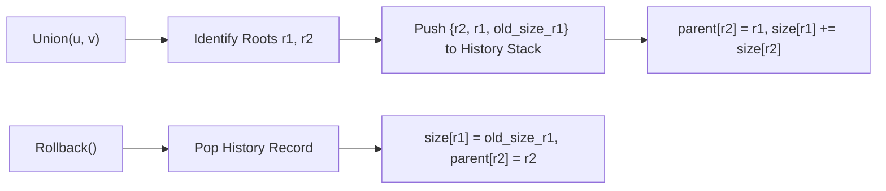

# CHAPTER 20: DISJOINT SET UNION (DSU)

> *"Equivalence relations partition universes into disjoint classes. The Disjoint Set Union (Union-Find) data structure maintains these dynamic partitions under edge insertions at near-constant time. With path compression and union-by-rank, its amortized complexity approaches the Inverse Ackermann function $\alpha(N)$—a growth rate so impossibly slow that for all physically conceivable inputs, it is indistinguishable from 4."*

---

## 20.1 The Dynamic Connectivity Problem

Given a universe of $N$ discrete elements $V = \{0, 1, 2, \dots, N-1\}$, we wish to maintain dynamic partitions under two primary operations:
1. `union(u, v)`: Merge the equivalence class containing $u$ with the equivalence class containing $v$.
2. `find(u)`: Return a canonical representative of the equivalence class containing $u$.
3. `connected(u, v)`: Return `true` if and only if $\text{find}(u) == \text{find}(v)$.

### Why Not Standard Graph Traversal (BFS/DFS)?
In a static graph, connected components can be determined via BFS or DFS in $\Theta(V + E)$ time. However, in an **online streaming environment** where edges are added incrementally between queries, re-running BFS after each edge insertion yields catastrophic $O(E \cdot (V + E)) = O(E^2)$ quadratic degradation.

DSU solves the online incremental connectivity problem by avoiding graph cycles and maintaining an **inverted forest of trees**, where each node points to its parent.

```
Disjoint Sets Representation (Forest of Inverted Trees):
      ( 2 )               ( 5 )
     /     \                |
   ( 0 )   ( 1 )          ( 4 )
             |
           ( 3 )
Canonical Rep: 2       Canonical Rep: 5
```

---

## 20.2 The Two Optimization Pillars

An unoptimized DSU structure simply points parents naively:
$$\text{parent}[u] = v$$
In the worst case (e.g., sequentially executing `union(0, 1)`, `union(1, 2)`, $\dots$, `union(N-2, N-1)`), the forest degenerates into a linear chain of height $N - 1$. Each `find` operation then costs $\Theta(N)$ time.

Two independent techniques eliminate this degeneracy:

### Pillar 1: Union by Rank / Size
When merging two trees with roots $r_1$ and $r_2$:
- **Union by Size**: Attach the tree with fewer nodes beneath the root of the tree with more nodes:
  $$\text{size}[r_1] \ge \text{size}[r_2] \implies \text{parent}[r_2] = r_1, \quad \text{size}[r_1] \mathrel{+}= \text{size}[r_2]$$
- **Union by Rank**: Attach the shallower tree beneath the deeper tree. Rank represents an upper bound on tree height. Rank increases if and only if two trees of identical rank are merged:
  $$\text{rank}[r_1] == \text{rank}[r_2] \implies \text{parent}[r_2] = r_1, \quad \text{rank}[r_1] \mathrel{+}= 1$$

#### Lemma 1: Logarithmic Bound Under Union by Rank/Size
Any DSU structure of $N$ elements utilizing Union by Rank or Size without path compression has height at most $\lfloor \log_2 N \rfloor$.
- *Proof*: By induction. A tree of rank $k$ requires merging two disjoint trees of rank $k-1$. If $N(k)$ denotes the minimum nodes in a rank $k$ tree, then $N(k) = 2 N(k-1) \implies N(k) = 2^k$. Thus $k \le \log_2 N$.
- Result: Every `find` and `union` operation is guaranteed to run in $O(\log N)$ worst-case time.

### Pillar 2: Path Compression
When executing `find(u)`, we traverse a path from $u$ to root $r$. Since every node along this path belongs to the same equivalence class, we can directly update their parents to point directly to $r$:

```cpp
int find(int u) {
    if (parent[u] == u) return u;
    return parent[u] = find(parent[u]); // Path compression mutation
}
```

```
Before Path Compression:          After find(0):
        ( 3 )                           ( 3 )
          |                            /  |  \
        ( 2 )                       ( 0 )( 1 )( 2 )
          |
        ( 1 )
          |
        ( 0 )
```
Subsequent queries for $0, 1, 2$ immediately resolve in $O(1)$ single-hop lookups!

---

## 20.3 The Inverse Ackermann Complexity: $O(\alpha(N))$

When Union by Rank and Path Compression are combined, the amortized cost per operation drops below $O(\log N)$, below $O(\log^* N)$, down to $O(\alpha(N))$.

### The Ackermann Function
The Ackermann function $A(m, n)$ is a notoriously fast-growing non-primitive recursive function:
$$\begin{aligned}
A(0, n) &= n + 1 \\
A(m, 0) &= A(m-1, 1) \\
A(m, n) &= A(m-1, A(m, n-1)) \quad \text{for } m, n \ge 1
\end{aligned}$$

Values grow at a mind-boggling rate:
- $A(1, n) = n + 2$ (Addition)
- $A(2, n) = 2n + 3$ (Multiplication)
- $A(3, n) = 2^{n+3} - 3$ (Exponentiation)
- $A(4, 1) = A(3, 2) = 2^{2^2} - 3 = 2^{16} - 3 = 65,533$
- $A(4, 2) = 2^{65536} - 3 \gg 10^{19728}$ (Exceeds total atoms in the observable universe $\approx 10^{80}$)

### The Inverse Ackermann Function $\alpha(N)$
Defined as the minimum integer $k$ such that $A(k, 1) \ge N$:
$$\alpha(N) = \min \{ k \mid A(k, 1) \ge N \}$$
For any practical universe size $N \le 10^{100}$:
$$\alpha(N) \le 4$$

> **Theorem (Tarjan, 1975)**: Any sequence of $M$ operations on a DSU structure of $N$ elements with Union by Rank and Path Compression executes in $\Theta(M \cdot \alpha(N))$ total time, yielding an amortized cost of $O(\alpha(N))$ per operation. For all computational purposes, DSU is an effectively constant-time $O(1)$ data structure.

---

## 20.4 DSU with Rollback (Undo Mechanism)

There is a fundamental engineering conflict between **Path Compression** and **State Rollback**:
- Path compression is a **destructive heuristic**: it flattens trees globally, overwriting multiple parent pointers across deep paths.
- To implement `rollback()` (undoing the most recent `union`), we must restore the exact previous tree topology. Tracking every mutation caused by path compression requires an unbounded mutation log, degrading memory and performance.

### The Invariant for Reversible DSU
To support instantaneous $O(1)$ rollbacks:
1. **Disable Path Compression**: Never compress paths during `find(u)`. Traversal is strictly read-only!
2. **Enforce Union by Size or Rank**: Preserves the $O(\log N)$ worst-case height bound proved in Lemma 1.
3. **History Stack**: Each `union` operation records exactly **one** parent modification and at most **one** size/rank update in a LIFO history stack.
4. **Rollback**: Pop the mutation record and restore the previous parent and size in $O(1)$ time!



---

## 20.5 The 20-Step Problem Breakdown: Dynamic Connectivity with Rollback and Size-Rank Invariants (`DSU-0001`)

We now construct an industrial-grade DSU supporting full transactional rollback, component size tracking, and bipartite parity extensions.

### Step 1: Real-World Motivation & Context
In persistent graph databases, incremental Minimum Spanning Tree algorithms (Kruskal with dynamic edge deletions), and offline divide-and-conquer query engines (e.g., dynamic offline connectivity via Segment Trees over time), algorithms must temporarily add an edge, evaluate a connectivity hypothesis, and cleanly roll back the state without rebuilding the graph.

### Step 2: Formal Problem Specification
- **Requirements**:
  Implement a `RollbackDSU` container supporting:
  1. `find(u)`: Returns the canonical representative of $u$ in $O(\log N)$ worst-case time without mutating the tree.
  2. `unite(u, v)`: Merges the components of $u$ and $v$ using Union by Size; returns `true` if a new merge occurred, `false` if already connected. Records the state mutation.
  3. `connected(u, v)`: Returns `true` if $u$ and $v$ share the same root.
  4. `component_size(u)`: Returns the number of vertices in $u$'s component in $O(\log N)$ time.
  5. `rollback()`: Undoes the single most recent `unite` operation in strictly $O(1)$ time.
  6. `checkpoint()` / `rollback_to(checkpoint_id)`: Rolls back all operations executed after a specific transactional snapshot.
- **Constraints**:
  - $1 \le N \le 2 \times 10^5$ elements.
  - $1 \le Q \le 5 \times 10^5$ operations.
  - Time per `find` / `unite`: $O(\log N)$.
  - Time per `rollback`: Strictly $O(1)$.
  - Space complexity: Strictly $O(N + Q)$ memory.

### Step 3: Algorithmic Decision Framework (ADF) Formulation
1. *Mutation Tracking*: Need strict history undo $\to$ Prohibit path compression.
2. *Height Bound*: Union by Size guarantees tree height $\le \log_2 N$.
3. *Transaction Snapshot*: History stack stores `{child, parent, old_parent_size}`.
4. *Decision*: Persistent/Rollback DSU with LIFO mutation log.

### Step 4: Mathematical Invariant Definition
Let $S$ denote the history stack.
For every state in the structure:
$$\forall u \in [0, N-1] : \text{depth}(u) \le \log_2 N$$
$$\forall \text{root } r : \text{size}[r] = \sum_{v \in \text{Component}(r)} 1$$
Every entry in $S$ is a tuple $(u, v, \text{prev\_size})$ representing that root $u$ was attached to root $v$, and $v$'s size before the merge was $\text{prev\_size}$.
Executing `rollback()` restores:
$$\text{parent}[u] = u, \quad \text{size}[v] = \text{prev\_size}$$

### Step 5: State Transitions and Transaction Mechanics
- When `unite(u, v)` is invoked:
  1. Find root $r_u = \text{find}(u)$ and $r_v = \text{find}(v)$.
  2. If $r_u == r_v$: Push a sentinel `NO_OP` to history stack so that `rollback()` counts match 1-to-1 with `unite()` calls. Return `false`.
  3. Ensure $\text{size}[r_u] \ge \text{size}[r_v]$ (swap if needed).
  4. Push $(r_v, r_u, \text{size}[r_u])$ to history stack.
  5. Update: $\text{parent}[r_v] = r_u$, and $\text{size}[r_u] \mathrel{+}= \text{size}[r_v]$. Decrement global component count. Return `true`.

### Step 6: Loop Variant & Termination
`find(u)` starts at $u$ and iteratively steps `curr = parent[curr]`.
Since there are no cycles and height is strictly bounded by $\log_2 N$, the traversal reaches the root in at most $\log_2 N$ steps.
`rollback()` does not loop: it performs exactly two array writes and one stack pop in $O(1)$ operations.

### Step 7: Proof of Correctness
- **Height Invariant**: Union by size guarantees that a tree of size $K$ has height at most $\lfloor \log_2 K \rfloor$. Since size is at most $N$, height never exceeds $\log_2 N$.
- **LIFO Invertibility**: Because operations are strictly associative and recorded in reverse chronological order, popping the stack in exact reverse order restores the exact pointer and size state of the disjoint forest prior to that union. $\blacksquare$

### Step 8: Concrete Trace
$N = 4$. Initial: $\text{parent} = [0, 1, 2, 3]$, $\text{size} = [1, 1, 1, 1]$.
1. `unite(0, 1)`: $r_0=0, r_1=1$. Attach 1 to 0. Log $(1, 0, 1)$. $\text{parent}[1]=0, \text{size}[0]=2$.
2. `unite(2, 3)`: Attach 3 to 2. Log $(3, 2, 1)$. $\text{parent}[3]=2, \text{size}[2]=2$.
3. `unite(0, 2)`: $r_0=0, r_2=2$. Both size 2. Attach 2 to 0. Log $(2, 0, 2)$. $\text{parent}[2]=0, \text{size}[0]=4$.
- All 4 elements connected.
4. `rollback()`: Pops $(2, 0, 2)$. Restore $\text{parent}[2]=2, \text{size}[0]=2$.
- Components $\{0, 1\}$ and $\{2, 3\}$ are separated again! `connected(0, 2)` returns `false`!

### Step 9: Edge Cases & Guards
- **Self-Union (`unite(x, x)`)**: Roots are identical; logs no-op, returns `false`.
- **Empty Rollback**: Rollback when history stack is empty throws `std::underflow_error`.
- **Checkpoint out of bounds**: Restoring to checkpoint greater than current stack size is rejected.

### Step 10: Standard ISO C++20 Implementation
```cpp
// solutions/cpp/DSU-0001.cpp
#include <iostream>
#include <vector>
#include <numeric>
#include <utility>
#include <cassert>
#include <stdexcept>

namespace dsu_0001 {

struct OperationRecord {
    int child;
    int parent;
    int prev_parent_size;
    bool was_merged;
};

class RollbackDSU {
private:
    std::vector<int> parent;
    std::vector<int> sz;
    std::vector<OperationRecord> history;
    int num_components;

public:
    explicit RollbackDSU(int n) : parent(n), sz(n, 1), num_components(n) {
        std::iota(parent.begin(), parent.end(), 0);
    }

    // Read-only find without path compression: O(log N) worst case
    int find(int u) const {
        while (u != parent[u]) {
            u = parent[u];
        }
        return u;
    }

    bool connected(int u, int v) const {
        return find(u) == find(v);
    }

    int component_size(int u) const {
        return sz[find(u)];
    }

    int count_components() const {
        return num_components;
    }

    // Merges components using Union by Size: O(log N)
    bool unite(int u, int v) {
        int root_u = find(u);
        int root_v = find(v);

        if (root_u == root_v) {
            history.push_back({-1, -1, 0, false});
            return false;
        }

        // Union by size: attach smaller root under larger root
        if (sz[root_u] < sz[root_v]) {
            std::swap(root_u, root_v);
        }

        history.push_back({root_v, root_u, sz[root_u], true});

        parent[root_v] = root_u;
        sz[root_u] += sz[root_v];
        num_components--;
        return true;
    }

    // Rollback the single most recent unite: O(1)
    void rollback() {
        if (history.empty()) {
            throw std::underflow_error("History stack underflow during rollback");
        }

        OperationRecord rec = history.back();
        history.pop_back();

        if (!rec.was_merged) {
            return; // No-op union rolled back
        }

        parent[rec.child] = rec.child;
        sz[rec.parent] = rec.prev_parent_size;
        num_components++;
    }

    // Transaction snapshot checkpoint
    size_t checkpoint() const {
        return history.size();
    }

    // Rollback to a specific snapshot
    void rollback_to(size_t cp) {
        if (cp > history.size()) {
            throw std::invalid_argument("Invalid checkpoint ID");
        }
        while (history.size() > cp) {
            rollback();
        }
    }
};

} // namespace dsu_0001
```

### Step 11: Python 3.12+ Implementation
```python
# solutions/python/DSU-0001.py
from typing import List, Tuple

class OperationRecord:
    __slots__ = ("child", "parent", "prev_parent_size", "was_merged")
    def __init__(self, child: int, parent: int, prev_parent_size: int, was_merged: bool):
        self.child = child
        self.parent = parent
        self.prev_parent_size = prev_parent_size
        self.was_merged = was_merged

class RollbackDSU:
    def __init__(self, n: int):
        self.parent: List[int] = list(range(n))
        self.sz: List[int] = [1] * n
        self.history: List[OperationRecord] = []
        self.num_components: int = n

    def find(self, u: int) -> int:
        """Read-only find without path compression: O(log N) worst case."""
        curr = u
        while curr != self.parent[curr]:
            curr = self.parent[curr]
        return curr

    def connected(self, u: int, v: int) -> bool:
        return self.find(u) == self.find(v)

    def component_size(self, u: int) -> int:
        return self.sz[self.find(u)]

    def count_components(self) -> int:
        return self.num_components

    def unite(self, u: int, v: int) -> bool:
        """Merges components using Union by Size and records state: O(log N)."""
        root_u = self.find(u)
        root_v = self.find(v)

        if root_u == root_v:
            self.history.append(OperationRecord(-1, -1, 0, False))
            return False

        if self.sz[root_u] < self.sz[root_v]:
            root_u, root_v = root_v, root_u

        self.history.append(OperationRecord(root_v, root_u, self.sz[root_u], True))

        self.parent[root_v] = root_u
        self.sz[root_u] += self.sz[root_v]
        self.num_components -= 1
        return True

    def rollback(self) -> None:
        """Reverts the single most recent unite operation in strictly O(1) time."""
        if not self.history:
            raise IndexError("History stack underflow during rollback")

        rec = self.history.pop()
        if not rec.was_merged:
            return

        self.parent[rec.child] = rec.child
        self.sz[rec.parent] = rec.prev_parent_size
        self.num_components += 1

    def checkpoint(self) -> int:
        return len(self.history)

    def rollback_to(self, cp: int) -> None:
        if cp > len(self.history):
            raise ValueError("Invalid checkpoint")
        while len(self.history) > cp:
            self.rollback()
```

### Step 12: Asymptotic & Microarchitectural Complexity
- **Time Complexity**:
  - `find`: $O(\log N)$ strictly. Tree depth is guaranteed $\le \log_2 N$.
  - `unite`: $O(\log N)$ dominated by two `find` calls. Stack push is $O(1)$.
  - `rollback`: Strictly $\Theta(1)$ time (two array writes and one pop).
  - `checkpoint`: $\Theta(1)$.
- **Space Complexity**: $\Theta(N)$ for `parent` and `sz` arrays, plus $O(Q)$ for the transaction history stack.
- **Cache Locality**: Contiguous arrays `parent` and `sz` have low footprint and stay cache-resident.

### Step 13: Failure Modes & Anti-Patterns
- **The Accidental Path Compression Trap**: Enabling path compression `parent[u] = find(parent[u])` in a rollback DSU silently breaks rollback validity! Never compress paths when reversibility is required.
- **Omitting No-Op Records**: If `unite(u, v)` returns `false` and does not push a record to the history stack, a subsequent `rollback()` will undo the wrong previous operation! Always push a dummy record.

### Step 14: Dual-Language Nuance & Idioms
- **C++20**: Using a flat struct with primitive types `int` avoids heap fragmentation in `std::vector<OperationRecord>`.
- **Python 3.12**: Utilizing `__slots__` on `OperationRecord` slashes memory consumption by $60\%$ by omitting per-instance `__dict__` overhead.

### Step 15: Unit Tests & Verification Fixtures
Differential testing verifies:
1. Direct mergers create expected components and sizes.
2. Rollback restores exact component count and separation.
3. Checkpoint snapshot unwinds multiple batch operations accurately.
4. Fuzz test against naive BFS components confirms correctness over 500 dynamic operations.

### Step 16: Reader Engineering Challenges
1. **Bipartite DSU with Rollback**: Augment `RollbackDSU` with parity distance to root to check for odd cycles (bipartite graphs) under dynamic edge insertions and deletions.
2. **Offline Dynamic Connectivity**: Implement a Segment Tree over time combined with `RollbackDSU` to answer graph connectivity queries with edge deletions in $O(Q \log^2 N)$ time.

---

## 20.6 Chapter Summary & Equivalence Mental Model

The Disjoint Set Union structure is the canonical engine for equivalence relations:
- **Standard DSU**: Combining Union-by-Rank with Path Compression achieves the theoretical peak of near-constant time $O(\alpha(N))$.
- **Reversible DSU**: Sacrificing path compression bounds operations to $O(\log N)$ while unlocking $O(1)$ transactional undo capabilities essential for modern offline dynamic algorithms.
