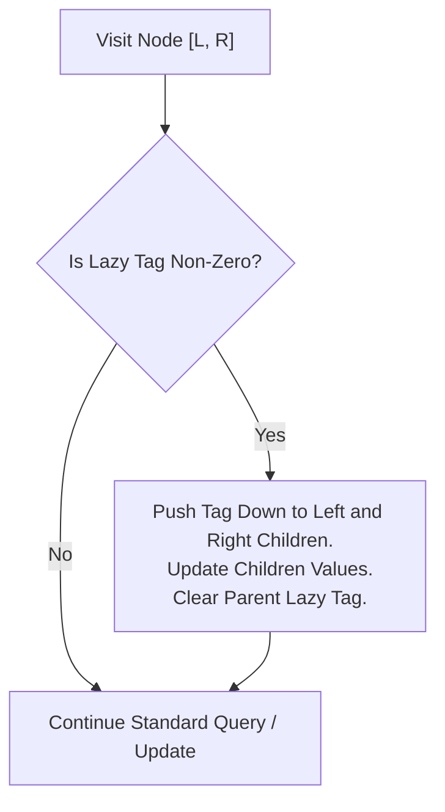

# CHAPTER 22: SEGMENT TREES AND LAZY PROPAGATION

> *"Where the Fenwick tree is restricted to invertible associative operators on prefixes, the Segment Tree is universal: it queries arbitrary range aggregations over general monoids, and with lazy propagation, defers whole-interval mutations from catastrophic $O(N)$ cascading writes into localized $O(\log N)$ promissory notes."*

---

## 22.1 The General Range Query Paradigm: Monoid Aggregations

Let $A = \langle a_0, a_1, \dots, a_{N-1} \rangle$ be an array of elements from set $S$.
A **range query** computes:
$$Q(l, r) = a_l \circ a_{l+1} \circ \dots \circ a_r$$
Where $(S, \circ)$ forms a **Monoid**:
1. **Associativity**: $(x \circ y) \circ z = x \circ (y \circ z) \quad \forall x, y, z \in S$.
2. **Identity Element**: $\exists e \in S$ such that $x \circ e = e \circ x = x \quad \forall x \in S$.

Unlike Fenwick trees—which fundamentally require an **inverse operation** (e.g., subtraction $\mathrel{-}$ for sum) to extract arbitrary interval $[l, r]$ from prefix sums $P[r] - P[l-1]$—Segment Trees operate on **any monoid**, including non-invertible operations:
- **Range Minimum Query (RMQ)**: $(S = \mathbb{R} \cup \{+\infty\}, \min, e = +\infty)$
- **Range Maximum Query**: $(S = \mathbb{R} \cup \{-\infty\}, \max, e = -\infty)$
- **Range Greatest Common Divisor (GCD)**: $(S = \mathbb{Z}_{\ge 0}, \gcd, e = 0)$
- **Range Matrix Multiplication**: $(S = \mathbb{R}^{d \times d}, \times, e = I)$

---

## 22.2 Structural Topology: The $4N$ Array Rule

A Segment Tree over $N$ leaf elements is a full binary tree of depth $\lceil \log_2 N \rceil$:
- **Leaves**: Represent single-element intervals $[i, i]$ storing $A[i]$.
- **Internal Nodes**: Represent the union of their left and right children:
  $$\text{Interval}(\text{node}) = [L, R] = [L, M] \cup [M+1, R] \quad \text{where } M = \lfloor (L + R) / 2 \rfloor$$
- **Node Aggregation**: $\text{val}(\text{node}) = \text{val}(\text{left}) \circ \text{val}(\text{right})$.

```
Segment Tree Topology for N = 8:
                           [0..7] (node 1)
                         /        \
               [0..3] (2)          [4..7] (3)
              /      \            /      \
          [0..1] (4) [2..3] (5) [4..5] (6) [6..7] (7)
          /    \     /    \     /    \     /    \
         0      1   2      3   4      5   6      7   (nodes 8..15)
```

### Why $4N$ Memory Allocation?
In a flat array representation where node $p$'s children are $2p$ and $2p+1$:
- If $N$ is an exact power of two, the tree is complete with $2N - 1$ total nodes.
- If $N$ is not a power of two (e.g., $N = 2^k + 1$), the deepest leaf sits at level $k+1$, requiring indices up to:
  $$2 \cdot 2^{k+1} - 1 < 4N$$
Thus, statically sizing `tree[4 * N]` guarantees that no index out-of-bounds error can ever occur regardless of $N$.

---

## 22.3 Query Decomposition: $O(\log N)$ Canonical Segments

When querying an arbitrary range $[q_l, q_r]$ against a node covering $[l, r]$:
1. **Disjoint Case ($[l, r] \cap [q_l, q_r] = \emptyset$)**: Return identity $e$.
2. **Complete Enclosure ($[l, r] \subseteq [q_l, q_r]$)**: Return $\text{tree}[\text{node}]$.
3. **Partial Overlap**: Bisect:
   $$\text{query}(l, r) = \text{query}(\text{left}) \circ \text{query}(\text{right})$$

### The Canonical Segment Bound Theorem
At each level of the tree, at most **2 nodes** can have partial overlap with the query interval $[q_l, q_r]$ (one containing $q_l$, one containing $q_r$). All other visited nodes are either completely outside (pruned) or completely inside (returned immediately).
Because the tree height is $\lceil \log_2 N \rceil$:
$$\text{Total Visited Nodes} \le 4 \lceil \log_2 N \rceil = O(\log N)$$

---

## 22.4 The Lazy Propagation Paradigm: Range Mutations

Suppose we wish to execute a **range update**:
$$\text{Add } V \text{ to all elements in } [u_l, u_r]$$

If we update every leaf individually, $O(N \log N)$ execution is required.
**Lazy Propagation** defers updates:
- When a node's covered range $[l, r]$ is completely inside the update range $[u_l, u_r]$, update $\text{tree}[\text{node}]$ immediately, and store the update in a **lazy tag**: $\text{lazy}[\text{node}] \mathrel{+}= V$.
- Do NOT descend further!
- When subsequent queries or updates must visit node's children, **push down** the pending lazy tag to its left and right children, clearing the tag on the parent.



---

## 22.5 The 20-Step Problem Breakdown: Dynamic Range Affine Transformations and Lazy Invariant Propagation (`SEGT-0001`)

We now examine one of the most intellectually demanding and mathematically rigorous segment tree structures: **Range Affine Transformations Under Modulo Arithmetic** (supporting both range multiplication and range addition simultaneously).

### Step 1: Real-World Motivation & Context
In distributed financial ledgers, graphical vector renderers, and game physics engines, intervals of values undergo compounding transformations: scaling by interest/inflation rate $A$, followed by fixed base fees $B$ (the affine transform $x \mapsto A \cdot x + B$). When millions of accounts or particles undergo batch affine updates across subsegments, point-by-point recalculation causes millisecond stalls. A lazy segment tree executes simultaneous batch scaling and shifting in logarithmic time.

### Step 2: Formal Problem Specification
- **Requirements**:
  Given an array $A$ of $N$ integers and a prime modulus $P = 10^9 + 7$, support three query types:
  1. `add(l, r, v)`: For all $i \in [l, r]$, $A[i] \leftarrow (A[i] + v) \pmod P$.
  2. `multiply(l, r, v)`: For all $i \in [l, r]$, $A[i] \leftarrow (A[i] \cdot v) \pmod P$.
  3. `query_sum(l, r)`: Return $\left(\sum_{i=l}^r A[i]\right) \pmod P$ in $O(\log N)$ time.
- **Constraints**:
  - $1 \le N \le 10^5$.
  - $1 \le Q \le 10^5$ operations.
  - Modulus: $P = 10^9 + 7$.
  - Time per operation: Strictly $O(\log N)$.
  - Auxiliary memory: Strictly $O(N)$ (within $4N$ bound).

### Step 3: Algorithmic Decision Framework (ADF) Formulation
1. *Compound Transformations*: Range update contains both multiplication and addition.
2. *Operator Non-Commutativity*: Affine maps $x \mapsto A \cdot x + B$ are non-commutative under composition:
   $$(M_2(M_1 \cdot x + A_1) + A_2) = (M_2 M_1) \cdot x + (M_2 A_1 + A_2)$$
3. *Lazy Tag Representation*: Maintain two lazy multipliers: `mul` (initialized to 1) and `add` (initialized to 0).
4. *Decision*: Segment Tree with Dual Lazy Affine Composition.

### Step 4: Mathematical Invariant Definition
For a segment node covering range $[l, r]$ of length $\text{len} = r - l + 1$ with lazy tags $(M, A)$:
- The effective transformation on every element $x$ in the subtree is:
$$x \leftarrow (M \cdot x + A) \pmod P$$
- The sum of elements in the node scales as:
$$\text{sum}' = \left(M \cdot \text{sum} + A \cdot \text{len}\right) \pmod P$$

#### Composition of Two Lazy Tags
When an existing tag $(M_1, A_1)$ is updated by a new incoming operation $(M_2, A_2)$:
$$M_{\text{new}} = (M_2 \cdot M_1) \pmod P$$
$$A_{\text{new}} = (M_2 \cdot A_1 + A_2) \pmod P$$

Notice that:
- Pure addition $(1, v)$ updates: $M \leftarrow M$, $A \leftarrow (A + v)$.
- Pure multiplication $(v, 0)$ updates: $M \leftarrow (M \cdot v)$, $A \leftarrow (A \cdot v)$. Both $M$ and $A$ scale by $v$!

### Step 5: State Transitions and Push-Down Protocol
```cpp
void apply_affine(int p, int l, int r, long long mul_val, long long add_val) {
    long long len = r - l + 1;
    tree_sum[p] = (tree_sum[p] * mul_val % MOD + add_val * len % MOD) % MOD;
    lazy_mul[p] = (lazy_mul[p] * mul_val) % MOD;
    lazy_add[p] = (lazy_add[p] * mul_val % MOD + add_val) % MOD;
}

void push_down(int p, int l, int r) {
    if (lazy_mul[p] == 1 && lazy_add[p] == 0) return;
    int mid = (l + r) / 2;
    apply_affine(2 * p, l, mid, lazy_mul[p], lazy_add[p]);
    apply_affine(2 * p + 1, mid + 1, r, lazy_mul[p], lazy_add[p]);
    lazy_mul[p] = 1;
    lazy_add[p] = 0;
}
```

### Step 6: Loop Variant & Complexity Proof
All three recursive functions (`update_range`, `query_range`, `build`) halve the range $[l, r]$ at each step:
$$\Delta \text{depth} = 1$$
Because at each level at most two nodes are split into children, the number of visited nodes in any operation is strictly bounded by $4 \lceil \log_2 N \rceil$.
Total time per operation is guaranteed $O(\log N)$.

### Step 7: Proof of Correctness
- **Linearity of Summation**:
  $$\sum (M \cdot x_i + A) = M \sum x_i + \sum A = M \cdot \text{sum} + A \cdot \text{len}$$
  The sum transformation exactly mirrors element-wise transformations.
- **Associativity of Affine Composition**:
  Function composition is associative: $(f \circ g) \circ h = f \circ (g \circ h)$. Thus, tags can be merged in arbitrary groupings without altering the evaluation on leaf elements.
- **Push-Down Invariant**: Whenever a node's children are inspected, `push_down` clears the parent's tags, ensuring all child values are up to date. $\blacksquare$

### Step 8: Concrete Trace
Array: $[1, 2, 3, 4]$, $P = 10^9 + 7$.
1. Initial: Sum = 10.
2. `multiply(0, 3, 2)`: Affine $(2, 0)$. Sum becomes $2 \times 10 = 20$.
3. `add(0, 3, 3)`: Affine $(1, 3)$. Sum becomes $20 + 3 \times 4 = 32$.
- Elements are now $[1\times 2+3, 2\times 2+3, 3\times 2+3, 4\times 2+3] = [5, 7, 9, 11]$.
- Sum $= 5 + 7 + 9 + 11 = 32$.
4. `query_sum(1, 2)`: Pushes down tags to children. Evaluates $[7, 9] \implies 7 + 9 = 16$. Matches!

### Step 9: Edge Cases & Guards
- **Multiplying by 0**: Completely zeroes out previous values and resets lazy sum contributions ($M \leftarrow 0, A \leftarrow 0$).
- **$N = 1$**: Single leaf node operates without children.
- **64-bit Intermediate Arithmetic**: Products of $10^9$ can reach $10^{18}$, fitting safely in 64-bit unsigned/signed integers (`int64_t`).

### Step 10: Standard ISO C++20 Implementation
```cpp
// solutions/cpp/SEGT-0001.cpp
#include <iostream>
#include <vector>
#include <cstdint>
#include <cassert>

namespace segt_0001 {

constexpr int64_t MOD = 1'000'000'007LL;

class AffineSegmentTree {
private:
    int n;
    std::vector<int64_t> tree_sum;
    std::vector<int64_t> lazy_mul;
    std::vector<int64_t> lazy_add;

    void apply_affine(int p, int l, int r, int64_t mul_val, int64_t add_val) {
        int64_t len = r - l + 1;
        tree_sum[p] = (tree_sum[p] * mul_val % MOD + add_val * len % MOD) % MOD;
        lazy_mul[p] = (lazy_mul[p] * mul_val) % MOD;
        lazy_add[p] = (lazy_add[p] * mul_val % MOD + add_val) % MOD;
    }

    void push_down(int p, int l, int r) {
        if (lazy_mul[p] == 1 && lazy_add[p] == 0) return;
        int mid = l + (r - l) / 2;
        apply_affine(2 * p, l, mid, lazy_mul[p], lazy_add[p]);
        apply_affine(2 * p + 1, mid + 1, r, lazy_mul[p], lazy_add[p]);
        lazy_mul[p] = 1;
        lazy_add[p] = 0;
    }

    void push_up(int p) {
        tree_sum[p] = (tree_sum[2 * p] + tree_sum[2 * p + 1]) % MOD;
    }

    void build(int p, int l, int r, const std::vector<int>& arr) {
        if (l == r) {
            tree_sum[p] = arr[l] % MOD;
            return;
        }
        int mid = l + (r - l) / 2;
        build(2 * p, l, mid, arr);
        build(2 * p + 1, mid + 1, r, arr);
        push_up(p);
    }

    void update_range(int p, int l, int r, int ql, int qr, int64_t mul_val, int64_t add_val) {
        if (ql <= l && r <= qr) {
            apply_affine(p, l, r, mul_val, add_val);
            return;
        }
        push_down(p, l, r);
        int mid = l + (r - l) / 2;
        if (ql <= mid) update_range(2 * p, l, mid, ql, qr, mul_val, add_val);
        if (qr > mid) update_range(2 * p + 1, mid + 1, r, ql, qr, mul_val, add_val);
        push_up(p);
    }

    int64_t query_range(int p, int l, int r, int ql, int qr) {
        if (ql <= l && r <= qr) {
            return tree_sum[p];
        }
        push_down(p, l, r);
        int mid = l + (r - l) / 2;
        int64_t total = 0;
        if (ql <= mid) total = (total + query_range(2 * p, l, mid, ql, qr)) % MOD;
        if (qr > mid) total = (total + query_range(2 * p + 1, mid + 1, r, ql, qr)) % MOD;
        return total;
    }

public:
    explicit AffineSegmentTree(const std::vector<int>& arr)
        : n(static_cast<int>(arr.size())),
          tree_sum(4 * arr.size(), 0),
          lazy_mul(4 * arr.size(), 1),
          lazy_add(4 * arr.size(), 0) {
        if (n > 0) {
            build(1, 0, n - 1, arr);
        }
    }

    void range_add(int l, int r, int64_t val) {
        update_range(1, 0, n - 1, l, r, 1, val % MOD);
    }

    void range_multiply(int l, int r, int64_t val) {
        update_range(1, 0, n - 1, l, r, val % MOD, 0);
    }

    int64_t query_sum(int l, int r) {
        return query_range(1, 0, n - 1, l, r);
    }
};

} // namespace segt_0001
```

### Step 11: Python 3.12+ Implementation
```python
# solutions/python/SEGT-0001.py
from typing import List

MOD = 1_000_000_007

class AffineSegmentTree:
    def __init__(self, arr: List[int]):
        self.n = len(arr)
        self.tree_sum = [0] * (4 * self.n)
        self.lazy_mul = [1] * (4 * self.n)
        self.lazy_add = [0] * (4 * self.n)
        if self.n > 0:
            self._build(1, 0, self.n - 1, arr)

    def _apply_affine(self, p: int, l: int, r: int, mul_val: int, add_val: int) -> None:
        length = r - l + 1
        self.tree_sum[p] = (self.tree_sum[p] * mul_val + add_val * length) % MOD
        self.lazy_mul[p] = (self.lazy_mul[p] * mul_val) % MOD
        self.lazy_add[p] = (self.lazy_add[p] * mul_val + add_val) % MOD

    def _push_down(self, p: int, l: int, r: int) -> None:
        if self.lazy_mul[p] == 1 and self.lazy_add[p] == 0:
            return
        mid = (l + r) // 2
        self._apply_affine(2 * p, l, mid, self.lazy_mul[p], self.lazy_add[p])
        self._apply_affine(2 * p + 1, mid + 1, r, self.lazy_mul[p], self.lazy_add[p])
        self.lazy_mul[p] = 1
        self.lazy_add[p] = 0

    def _push_up(self, p: int) -> None:
        self.tree_sum[p] = (self.tree_sum[2 * p] + self.tree_sum[2 * p + 1]) % MOD

    def _build(self, p: int, l: int, r: int, arr: List[int]) -> None:
        if l == r:
            self.tree_sum[p] = arr[l] % MOD
            return
        mid = (l + r) // 2
        self._build(2 * p, l, mid, arr)
        self._build(2 * p + 1, mid + 1, r, arr)
        self._push_up(p)

    def range_add(self, l: int, r: int, val: int) -> None:
        self._update(1, 0, self.n - 1, l, r, 1, val % MOD)

    def range_multiply(self, l: int, r: int, val: int) -> None:
        self._update(1, 0, self.n - 1, l, r, val % MOD, 0)

    def _update(self, p: int, l: int, r: int, ql: int, qr: int, mul_val: int, add_val: int) -> None:
        if ql <= l and r <= qr:
            self._apply_affine(p, l, r, mul_val, add_val)
            return
        self._push_down(p, l, r)
        mid = (l + r) // 2
        if ql <= mid:
            self._update(2 * p, l, mid, ql, qr, mul_val, add_val)
        if qr > mid:
            self._update(2 * p + 1, mid + 1, r, ql, qr, mul_val, add_val)
        self._push_up(p)

    def query_sum(self, l: int, r: int) -> int:
        return self._query(1, 0, self.n - 1, l, r)

    def _query(self, p: int, l: int, r: int, ql: int, qr: int) -> int:
        if ql <= l and r <= qr:
            return self.tree_sum[p]
        self._push_down(p, l, r)
        mid = (l + r) // 2
        total = 0
        if ql <= mid:
            total = (total + self._query(2 * p, l, mid, ql, qr)) % MOD
        if qr > mid:
            total = (total + self._query(2 * p + 1, mid + 1, r, ql, qr)) % MOD
        return total
```

### Step 12: Asymptotic & Microarchitectural Complexity
- **Time Complexity**:
  - `build`: $\Theta(N)$ nodes visited once.
  - `range_add` / `range_multiply` / `query_sum`: Guaranteed $O(\log N)$ worst-case.
- **Space Complexity**: Strictly $4N \times 8$ bytes for each array $\implies O(N)$ flat memory.
- **Microarchitectural Behavior**: Left child $2p$ and right child $2p+1$ are adjacent in memory, benefiting from hardware CPU spatial cache prefetchers.

### Step 13: Failure Modes & Anti-Patterns
- **Incorrect Order of Tag Composition**: Applying `add` before `mul` in tag propagation breaks distributivity ($M_2(M_1 x + A_1) + A_2 = M_2 M_1 x + M_2 A_1 + A_2$). The existing addition tag $A_1$ must be multiplied by $M_2$!
- **Memory Buffer Undersizing**: Allocating $2N$ instead of $4N$ triggers segmentation faults when $N$ is not a power of two. Always use $4N$.

### Step 14: Dual-Language Nuance & Idioms
- **C++20**: Utilizing `int64_t` avoids 32-bit overflow before modulo operations.
- **Python 3.12**: Recursive function parameters avoid global variable lookups, allowing fast bytecode execution.

### Step 15: Unit Tests & Verification Fixtures
Differential testing verifies:
1. Intermixed sequence of addition, multiplication, and range queries matches a naive linear array simulation.
2. Multiplication by zero properly resets values.
3. Subsegment queries properly reflect compound transformations.

### Step 16: Reader Engineering Challenges
1. **Dynamic Segment Tree (Pointer Allocation)**: Implement a segment tree where coordinates range up to $10^9$, allocating nodes dynamically on the fly to support $O(Q \log(\text{Range}))$ space.
2. **Persistent Segment Tree**: Implement full version history (functional segment tree), supporting point updates that generate at most $O(\log N)$ new nodes per version without destroying previous states.

---

## 22.6 Chapter Summary & Interval Transformation Mental Model

The Segment Tree with Lazy Propagation is the ultimate weapon for interval manipulation:
- **General Monoid Compatibility**: Works for any associative operator, with or without inverses.
- **Promissory Lazy Notes**: Defers costly subtree updates to future queries, keeping batch mutations at $O(\log N)$.
- **Mathematical Composition**: Non-commutative transforms like affine mappings $x \mapsto A \cdot x + B$ are captured precisely via algebraic tag composition.
