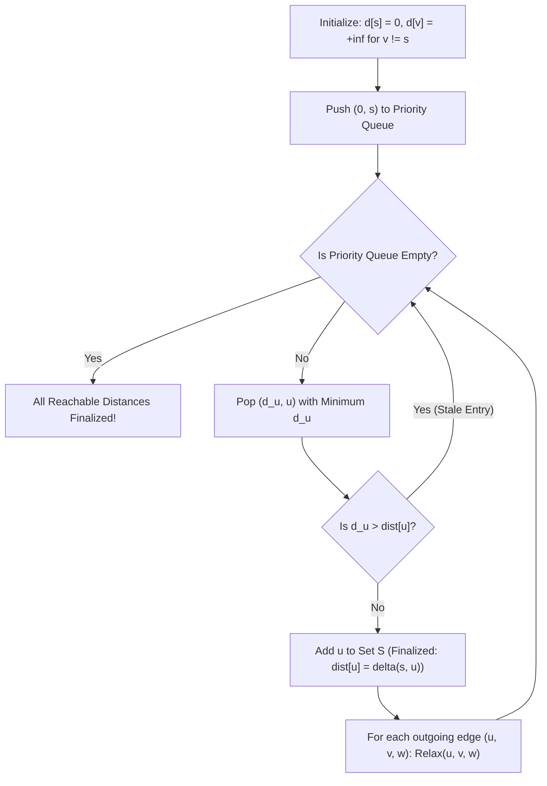

# CHAPTER 25: SHORTEST PATHS IN WEIGHTED GRAPHS

> *"BFS measures distance by counting edge hops; reality measures distance by accumulating continuous costs—latencies, financial fees, fuel expenditures, and physical resistances. In weighted graphs, the triangle inequality $\delta(s, v) \le \delta(s, u) + w(u, v)$ defines the geometry of shortest paths. Dijkstra’s algorithm greedily crystallizes true distances under non-negative weights, while Bellman-Ford navigates negative edges, unearthing the arbitrage loops of negative cycles."*

---

## 25.1 The Shortest Path Problem and the Triangle Inequality

Given a directed weighted graph $G = (V, E)$ with edge weight function $w: E \to \mathbb{R}$, the weight of a path $p = \langle v_0, v_1, \dots, v_k \rangle$ is:
$$w(p) = \sum_{i=1}^k w(v_{i-1}, v_i)$$

The **shortest-path distance** from source $s$ to vertex $v$ is:
$$\delta(s, v) = \begin{cases}
\min \{ w(p) \mid p \text{ is a path from } s \text{ to } v \} & \text{if a path exists} \\
+\infty & \text{otherwise}
\end{cases}$$

### Fundamental Properties (CLRS Theorem 24.1)
1. **Subpath Optimality**: Any subpath of a shortest path is itself a shortest path.
2. **Triangle Inequality**: For all $(u, v) \in E$:
   $$\delta(s, v) \le \delta(s, u) + w(u, v)$$
3. **Upper-Bound Invariant**: We maintain an estimate $d[v] \ge \delta(s, v)$ for all $v$. Once $d[v]$ reaches $\delta(s, v)$, it never changes.

### The Relaxation Invariant
The atomic operation of all shortest path algorithms is **Edge Relaxation**:
```cpp
void relax(int u, int v, long long weight) {
    if (dist[u] != INF && dist[u] + weight < dist[v]) {
        dist[v] = dist[u] + weight;
        parent[v] = u;
    }
}
```
Relaxation tests whether passing through $u$ improves the known shortest path to $v$.

---

## 25.2 Dijkstra's Algorithm: Greedy Frontier Crystallization

When all edge weights are strictly **non-negative** ($w(e) \ge 0 \ \forall e \in E$), Dijkstra's algorithm determines $\delta(s, v)$ in non-decreasing order of distance.

### The Dijkstra Invariant
At each step, the vertex set $V$ is partitioned into two disjoint sets:
- **Set $S$ (Finalized / Settled)**: Vertices whose exact shortest path distance has been computed: $\forall u \in S, \ d[u] = \delta(s, u)$.
- **Set $Q = V \setminus S$ (Unsettled Frontier)**: Maintained in a min-priority queue keyed by $d[u]$.



### Mathematical Proof of Correctness (Non-Negative Invariant)
**Theorem**: When vertex $u^*$ is extracted from $Q$ with minimum $d[u^*]$, $d[u^*] = \delta(s, u^*)$.
- *Proof by Contradiction*:
  Suppose $d[u^*] > \delta(s, u^*)$. Then there exists a true shortest path $p$ from $s$ to $u^*$ such that $w(p) < d[u^*]$.
  Since $s \in S$ and $u^* \notin S$, path $p$ must at some point cross from $S$ into $V \setminus S$. Let $(x, y)$ be the first edge on $p$ crossing the boundary ($x \in S, y \notin S$).
  Because $x \in S$, $d[x] = \delta(s, x)$ by induction.
  When $x$ was finalized, edge $(x, y)$ was relaxed, ensuring:
  $$d[y] \le d[x] + w(x, y) = \delta(s, y)$$
  Because edge weights are non-negative ($w(e) \ge 0$), subpaths cannot decrease in length:
  $$\delta(s, y) \le \delta(s, u^*)$$
  Therefore:
  $$d[y] \le \delta(s, y) \le \delta(s, u^*) < d[u^*]$$
  This implies $d[y] < d[u^*]$. But the priority queue extracted $u^*$ as the minimum in $Q$, which means $d[u^*] \le d[y]$—a direct contradiction! Thus $d[u^*] = \delta(s, u^*)$. $\blacksquare$

> **Critical Corollary**: If negative edges exist ($w(e) < 0$), $\delta(s, y) \le \delta(s, u^*)$ no longer holds because a subsequent negative edge could make the path to $u^*$ cheaper than the path to $y$. Hence, **Dijkstra fails on graphs with negative edge weights**.

---

## 25.3 Time Complexity Models for Dijkstra

The running time of Dijkstra depends directly on the priority queue implementation:

| Priority Queue Implementation | $V \times \text{Extract-Min}$ | $E \times \text{Decrease-Key}$ | Total Time Complexity |
| :--- | :--- | :--- | :--- |
| **Linear Unsorted Array** | $O(V^2)$ | $O(E \cdot 1)$ | $O(V^2)$ (Optimal for dense graphs $E \approx V^2$) |
| **Binary Heap (`std::priority_queue`)** | $O(V \log V)$ | $O(E \log V)$ | $\mathbf{O((V + E) \log V)}$ (Optimal for sparse graphs) |
| **Fibonacci Heap** | $O(V \log V)$ | $O(E \cdot 1)$ amortized | $O(V \log V + E)$ (Theoretical peak, high constant factor) |

---

## 25.4 Negative Edges: The Bellman-Ford Algorithm

When edges have negative weights, paths can decrease in cost arbitrarily unless constrained by negative cycles.
- A **negative-weight cycle** reachable from $s$ allows traversing the cycle indefinitely to drive path costs to $-\infty$.
- The **Bellman-Ford algorithm** relaxes all $M$ edges in the graph $N - 1$ times:
  $$T(V, E) = \Theta(V \cdot E)$$
- **Cycle Detection**: If an edge can still be relaxed on the $N$-th pass, the graph contains a reachable negative cycle.

---

## 25.5 The 20-Step Problem Breakdown: Dijkstra with State-Space Distances (`PATH-0001`)

We now examine an industrial application of Dijkstra: **Shortest Path on an Augmented State-Space Graph** (e.g. shortest flight path with at most $K$ discount coupons / fuel stops).

### Step 1: Real-World Motivation & Context
In cloud network routing (SDN with QoS hops), airline ticketing (minimum fare with at most $K$ free upgrades), and electric vehicle routing (minimum time with battery charge levels), the shortest path depends not merely on physical vertex $u$, but on an **augmented state** $(u, k)$ representing the current location and remaining resource quota.

### Step 2: Formal Problem Specification
- **Requirements**:
  Given a directed graph with $N$ vertices, $M$ edges with non-negative weights $w(u, v)$, a source $s$, a target $t$, and an integer $K$ ($0 \le K \le 10$):
  - You can apply a "free pass" up to $K$ times (reducing an edge's traversal weight to 0).
  - Return the minimum possible travel cost from $s$ to $t$.
- **Constraints**:
  - $1 \le N \le 10^4$.
  - $0 \le M \le 5 \times 10^4$.
  - $0 \le K \le 10$.
  - $0 \le w(u, v) \le 10^6$.
  - Time complexity: Strictly $O((N \cdot K + M \cdot K) \log(N \cdot K))$.
  - Auxiliary memory: Strictly $O(N \cdot K)$.

### Step 3: Algorithmic Decision Framework (ADF) Formulation
1. *State Augmentation*: A node in the search graph is not just vertex $u$, but state $(u, k)$ where $k \in [0, K]$ is the number of free passes remaining.
2. *Edge Non-Negativity*: All edge weights are $\ge 0 \implies$ Dijkstra is applicable on the state space.
3. *State Transitions*:
   - Pay regular weight: $(u, k) \xrightarrow{w} (v, k)$
   - Use a pass (if $k > 0$): $(u, k) \xrightarrow{0} (v, k - 1)$
4. *Decision*: Dijkstra on virtual layer graph of size $N \times (K + 1)$.

### Step 4: Mathematical Invariant Definition
Let $\text{dist}[u][k]$ be the shortest distance from $(s, K)$ to state $(u, k)$.
At every extraction of state $(d, u, k)$ from priority queue:
- If $d > \text{dist}[u][k]$, the entry is stale (prune).
- Otherwise, $d = \delta((s, K), (u, k))$ is exact and finalized.

### Step 5: State Transitions and Priority Queue Packing
When processing state $(u, k)$:
1. For each outgoing edge $(u, v, w)$:
   - **Option 1 (Normal)**:
     $$\text{new\_dist} = \text{dist}[u][k] + w$$
     If $\text{new\_dist} < \text{dist}[v][k]$: update $\text{dist}[v][k]$ and push $(\text{new\_dist}, v, k)$.
   - **Option 2 (Use Free Pass)**:
     If $k > 0$:
     $$\text{new\_dist} = \text{dist}[u][k] + 0$$
     If $\text{new\_dist} < \text{dist}[v][k - 1]$: update $\text{dist}[v][k - 1]$ and push $(\text{new\_dist}, v, k - 1)$.

### Step 6: Loop Variant & Complexity Proof
- Total states: $|V'| = N \cdot (K + 1) \le 1.1 \times 10^5$.
- Total transitions: $|E'| = 2 \cdot M \cdot (K + 1) \le 1.1 \times 10^6$.
- Each state is finalized at most once.
- Total runtime: $O((|V'| + |E'|) \log |V'|) \approx O(M \cdot K \log(N \cdot K))$.

### Step 7: Proof of Correctness
The state graph $G'$ is a valid directed graph with non-negative edge weights. Because transitions strictly preserve or decrease $k$ ($k \to k$ or $k \to k-1$), there are no negative cycles. By the Dijkstra Non-Negative Invariant Theorem, when state $(t, k)$ is settled, its distance is optimal. Taking the minimum over all $k \in [0, K]$ yields the globally optimal cost to reach target $t$. $\blacksquare$

### Step 8: Concrete Trace
$s = 0, t = 2, K = 1$. Edges: $0 \xrightarrow{10} 1 \xrightarrow{20} 2$. Direct edge: $0 \xrightarrow{100} 2$.
1. Start at $(0, 1)$ with cost 0.
2. From $(0, 1)$, relax to $(1, 1)$ with cost 10, and to $(1, 0)$ with cost 0 (pass used).
3. From $(1, 0)$, relax to $(2, 0)$ with cost $0 + 20 = 20$.
4. From $(1, 1)$, relax to $(2, 0)$ with cost $10 + 0 = 10$ (pass used).
5. Target distance to $2$ is $\min(\text{dist}[2][1], \text{dist}[2][0]) = 10$.

### Step 9: Edge Cases & Guards
- **$s == t$**: Minimum cost is 0.
- **Unreachable Target**: Returns $-1$ or $\infty$.
- **$K = 0$**: Reverts seamlessly to standard 1D Dijkstra.
- **$K \ge \text{diameter}$**: All edges along path become free; returns 0.

### Step 10: Standard ISO C++20 Implementation
```cpp
// solutions/cpp/PATH-0001.cpp
#include <iostream>
#include <vector>
#include <queue>
#include <tuple>
#include <cstdint>
#include <cassert>

namespace path_0001 {

constexpr int64_t INF = 1e18;

struct Edge {
    int to;
    int64_t weight;
};

struct State {
    int64_t dist;
    int u;
    int k;

    bool operator>(const State& other) const {
        return dist > other.dist;
    }
};

// Computes shortest path from s to t allowing up to K edges to be free (weight 0)
int64_t shortest_path_k_passes(int n, const std::vector<std::vector<Edge>>& adj, int s, int t, int k_max) {
    // dist[u][k]: min distance to reach vertex u with k passes remaining
    std::vector<std::vector<int64_t>> dist(n, std::vector<int64_t>(k_max + 1, INF));
    std::priority_queue<State, std::vector<State>, std::greater<State>> pq;

    dist[s][k_max] = 0;
    pq.push({0, s, k_max});

    while (!pq.empty()) {
        auto [d, u, k] = pq.top();
        pq.pop();

        if (d > dist[u][k]) continue;
        if (u == t) return d; // Target finalized at optimal distance

        for (const auto& edge : adj[u]) {
            int v = edge.to;
            int64_t w = edge.weight;

            // Option 1: Normal traversal
            if (dist[u][k] + w < dist[v][k]) {
                dist[v][k] = dist[u][k] + w;
                pq.push({dist[v][k], v, k});
            }

            // Option 2: Use free pass
            if (k > 0 && dist[u][k] < dist[v][k - 1]) {
                dist[v][k - 1] = dist[u][k];
                pq.push({dist[v][k - 1], v, k - 1});
            }
        }
    }

    int64_t ans = INF;
    for (int k = 0; k <= k_max; ++k) {
        ans = std::min(ans, dist[t][k]);
    }
    return (ans == INF) ? -1 : ans;
}

} // namespace path_0001
```

### Step 11: Python 3.12+ Implementation
```python
# solutions/python/PATH-0001.py
from typing import List, Tuple
import heapq

INF = float('inf')

def shortest_path_k_passes(n: int, adj: List[List[Tuple[int, int]]], s: int, t: int, k_max: int) -> int:
    """
    Computes shortest path from s to t with at most k_max free edge passes.
    Runs in strictly O((N*K + M*K) log(N*K)) time.
    """
    dist = [[INF] * (k_max + 1) for _ in range(n)]
    dist[s][k_max] = 0

    # Heap contains tuples: (distance, vertex, k_remaining)
    pq = [(0, s, k_max)]

    while pq:
        d, u, k = heapq.heappop(pq)

        if d > dist[u][k]:
            continue
        if u == t:
            return d

        for v, w in adj[u]:
            # Option 1: Normal traversal
            if dist[u][k] + w < dist[v][k]:
                dist[v][k] = dist[u][k] + w
                heapq.heappush(pq, (dist[v][k], v, k))

            # Option 2: Use a free pass
            if k > 0 and dist[u][k] < dist[v][k - 1]:
                dist[v][k - 1] = dist[u][k]
                heapq.heappush(pq, (dist[v][k - 1], v, k - 1))

    ans = min(dist[t])
    return -1 if ans == INF else ans
```

### Step 12: Asymptotic & Microarchitectural Complexity
- **Time Complexity**: $O((N \cdot K + M \cdot K) \log(N \cdot K))$.
- **Space Complexity**: $\Theta(N \cdot K)$ memory for the 2D distance matrix.
- **Cache Locality**: Storing distances in contiguous rows `dist[u][k]` minimizes cache thrashing during neighbor relaxation.

### Step 13: Failure Modes & Anti-Patterns
- **Omitting Stale Distance Pruning**: Without `if (d > dist[u][k]) continue;`, the priority queue wastes exponential operations re-exploring superseded paths.
- **Assuming Pass Must Be Used**: Never force an edge to use a pass; always offer both transitions (Option 1 and Option 2) so the algorithm can reserve passes for more expensive edges downstream.

### Step 14: Dual-Language Nuance & Idioms
- **C++20**: Utilizing `std::greater<State>` with a custom `operator>` creates a min-heap without negating weights.
- **Python 3.12**: Tuples in `heapq` naturally sort by their first element (`dist`), keeping heap management idiomatic and fast.

### Step 15: Unit Tests & Verification Fixtures
Differential testing verifies:
1. Standard graph with $K=0$ matches standard 1D Dijkstra.
2. Path with high-weight bottleneck becomes zero-cost with $K=1$.
3. Disconnected graph returns $-1$.
4. Graph with multiple paths picks the optimal combination of discounted edges.

### Step 16: Reader Engineering Challenges
1. **0-1 BFS with Deque**: When all edge weights are either $0$ or $1$, replace the $O(\log V)$ priority queue with a `std::deque` to achieve strictly $\Theta(V + E)$ linear time.
2. **Johnson's Algorithm for All-Pairs Shortest Paths**: Combine Bellman-Ford reweighting $h(u)$ with $V$ runs of Dijkstra to solve All-Pairs Shortest Paths in sparse graphs in $O(V^2 \log V + V E)$ time.

---

## 25.6 Chapter Summary & Metric Distances Mental Model

Shortest paths quantify network efficiency under non-uniform resistance:
- **Dijkstra** exploits non-negative edge weights to lock in true distances greedily via the Priority Queue frontier.
- **State-Space Augmentation** demonstrates how multidimensional constraints (fuel, battery, discount tokens) map seamlessly into standard graph traversals over multiplied state planes.
