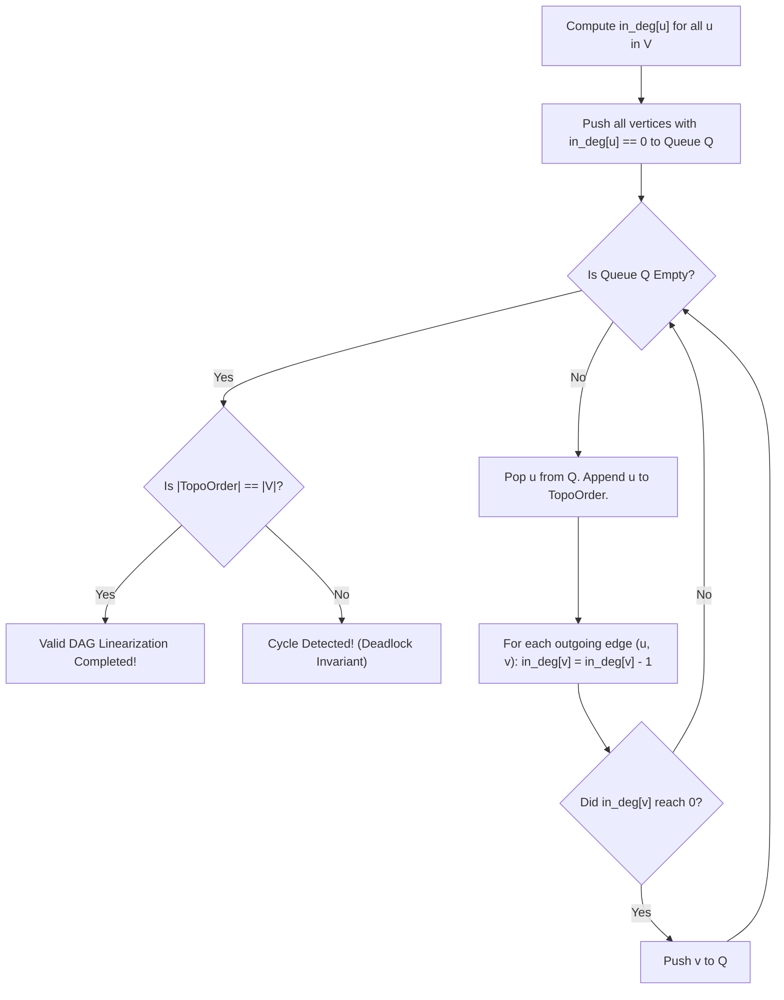

# CHAPTER 26: DIRECTED ACYCLIC GRAPHS (DAGS) AND TOPOLOGICAL SORTING

> *"A Directed Acyclic Graph is the algebraic manifestation of causality. Edges represent prerequisite constraints, time precedence, and dependency flows. Because no cycle exists to trap the arrow of time, a DAG can always be flattened into a linear topological order—transforming NP-hard optimization problems on general graphs into linear-time dynamic programs."*

---

## 26.1 The DAG Abstraction and Causal Ordering

A **Directed Acyclic Graph (DAG)** is a directed graph containing no directed cycles:
$$\nexists \ \langle v_0, v_1, \dots, v_k \rangle \quad \text{such that } (v_{i-1}, v_i) \in E \ \forall i \in [1, k] \land v_k = v_0$$

### Topological Sort Definition
A **Topological Sort** of a DAG $G = (V, E)$ is a linear ordering of its vertices $L = \langle v_1, v_2, \dots, v_N \rangle$ such that for every directed edge $(u, v) \in E$, $u$ appears before $v$ in the ordering:
$$\forall (u, v) \in E \implies \text{position}(u) < \text{position}(v)$$

```
Causal Precedence in a DAG:
  [ Math 101 ] --------> [ Algorithms 201 ] --------> [ Compilers 401 ]
        |                         ^                         ^
        v                         |                         |
  [ Discrete Math 102 ] ----------+                         |
        |                                                   |
        +---------------------------------------------------+

Valid Topological Linearization:
< Math 101, Discrete Math 102, Algorithms 201, Compilers 401 >
```

### Theorem: The Existence of Topological Sort
**Theorem**: A directed graph $G$ possesses a topological sort if and only if $G$ is a Directed Acyclic Graph (DAG).
- *Proof ($\implies$)*: Suppose $G$ has a topological sort $L$, but contains a directed cycle $C = \langle v_0, v_1, \dots, v_k, v_0 \rangle$. By definition of topological sort, $\text{pos}(v_0) < \text{pos}(v_1) < \dots < \text{pos}(v_k) < \text{pos}(v_0)$, which requires $\text{pos}(v_0) < \text{pos}(v_0)$—an impossible arithmetic contradiction!
- *Proof ($\impliedby$)*: In Section 26.2 and 26.3, we provide constructive algorithms (Kahn's and Tarjan's DFS) that produce a valid topological sort for any graph without cycles. $\blacksquare$

---

## 26.2 Algorithm 1: Kahn's Algorithm (In-Degree Elimination)

Invented by Arthur Kahn in 1962, this algorithm operates via **source elimination**:

### The In-Degree Invariant
Let $\text{in\_deg}[u]$ denote the number of incoming edges directed into $u$:
$$\text{in\_deg}[u] = |\{ v \in V \mid (v, u) \in E \}|$$
- If $\text{in\_deg}[u] == 0$, vertex $u$ has **zero prerequisites**; it can be scheduled immediately!



### Cycle Detection Property
If the graph contains a directed cycle, the in-degree of vertices in the cycle can never drop to 0. Consequently, they are never pushed to queue $Q$.
When $Q$ empties:
$$|\text{TopoOrder}| < N \iff \text{Graph contains a Cycle}$$

---

## 26.3 Algorithm 2: Tarjan's DFS (Reverse Post-Order)

DFS provides an alternative topological sort through the **CLRS Parenthesis Theorem**:
- When a DFS completes exploring all descendants of vertex $u$, $u$ is stamped with finish time $f[u]$.
- In a DAG, all descendants of $u$ finish before $u$.
- **Theorem**: Sorting vertices by decreasing finish time $f[u]$ produces a valid topological order!

```cpp
void dfs(int u) {
    state[u] = VISITING; // Gray: on current recursion path
    for (int v : adj[u]) {
        if (state[v] == VISITING) {
            has_cycle = true; // Back-edge detected!
            return;
        }
        if (state[v] == UNVISITED) dfs(v);
    }
    state[u] = VISITED; // Black: finalized
    topo_order.push_back(u); // Appended in post-order
}
// Final topological order is reverse(topo_order)
```

---

## 26.4 Dynamic Programming on DAGs: Linear-Time Optimizations

The existence of a topological order trivializes path optimization problems that are NP-hard on general graphs:
- **Longest Path in a General Graph**: Strongly NP-Hard (Hamiltonian Path reduction).
- **Longest Path in a DAG**: **Trivially Solvable in $\Theta(V + E)$ Time!**

### The DP Recurrence
Iterate through vertices in topological order $u_1, u_2, \dots, u_N$:
$$\text{dp}[v] = \max_{(u, v) \in E} (\text{dp}[u] + w(u, v))$$
Because every edge $(u, v)$ points forward in topological order, $\text{dp}[u]$ is guaranteed to be fully computed before $\text{dp}[v]$ is evaluated! No memoization overhead, no recursion, pure single-pass array updates.

---

## 26.5 The 20-Step Problem Breakdown: Lexicographically Smallest TopoSort and Cycle Isolation (`DAG-0001`)

We now construct an industrial dependency resolution engine: compiling task prerequisites, detecting cyclic deadlocks, and determining the unique **Lexicographically Smallest Topological Schedule** when multiple valid linearizations exist.

### Step 1: Real-World Motivation & Context
In software build systems (e.g. Bazel, Make, CMake) and package managers (e.g. npm, Cargo, pip), compilation targets have dependencies. When multiple independent tasks are ready for compilation simultaneously, build systems schedule them deterministically in alphabetical/lexicographical order to ensure reproducible binary builds. If a circular dependency exists (Package A $\to$ Package B $\to$ Package A), the build engine must fail fast and isolate the cycle.

### Step 2: Formal Problem Specification
- **Requirements**:
  Given $N$ tasks labeled $0$ to $N - 1$ and a list of directed prerequisite pairs $(u, v)$ indicating that task $u$ must be executed before task $v$:
  1. Detect if a directed dependency cycle exists. If a cycle exists, return an empty schedule.
  2. If acyclic, return the **lexicographically smallest** topological ordering of tasks.
- **Constraints**:
  - $1 \le N \le 10^5$.
  - $0 \le M \le 2 \times 10^5$.
  - Time complexity: Strictly $O((N + M) \log N)$.
  - Auxiliary memory: Strictly $O(N + M)$.

### Step 3: Algorithmic Decision Framework (ADF) Formulation
1. *Causal Scheduling*: DAG Dependency $\to$ Topological Sort.
2. *Tie-Breaking Policy*: Lexicographical order among ready candidates.
3. *Data Structure Choice*: Replace standard FIFO queue in Kahn's algorithm with a **Min-Priority Queue** (`std::priority_queue<int, ..., std::greater<int>>`).
4. *Decision*: Kahn's Algorithm augmented with Min-Heap.

### Step 4: Mathematical Invariant Definition
Let $H$ be a min-priority queue containing all vertices $u$ with $\text{in\_deg}[u] == 0$.
At every step:
- The vertex $u = H.\text{extract\_min}()$ is the smallest indexed task among all currently unblocked tasks.
- Appending $u$ to schedule preserves both the DAG causal invariant and the greedy lexicographical choice invariant.

### Step 5: State Transitions and Progress Mechanics
1. Compute $\text{in\_deg}[u]$ for all $u \in [0, N-1]$.
2. For each $i \in [0, N-1]$:
   - If $\text{in\_deg}[i] == 0$: push $i$ to Min-Heap $H$.
3. While $H$ is not empty:
   - Pop $u = H.\text{top}()$.
   - Append $u$ to result vector `order`.
   - For each dependent task $v \in \text{adj}[u]$:
     - Decrement $\text{in\_deg}[v]$.
     - If $\text{in\_deg}[v] == 0$: push $v$ to Min-Heap $H$.
4. If `order.size() == N`: Return `order`.
5. Else: Return `{}` (Cycle detected).

### Step 6: Loop Variant & Complexity Proof
- Each vertex enters Min-Heap $H$ at most once.
- Each vertex pop costs $O(\log N)$.
- Each edge $(u, v)$ is relaxed once, possibly triggering a heap push costing $O(\log N)$.
Total Heap Operations $\le N + M$.
Total Time: $\Theta((N + M) \log N)$ strictly.

### Step 7: Proof of Correctness
- **Topological Invariant**: A task $v$ is only pushed to $H$ when $\text{in\_deg}[v] == 0$, guaranteeing that all its prerequisites have already been popped and appended to `order`.
- **Lexicographical Optimality**: At each position $k$ in the schedule, the algorithm selects the smallest available candidate from $H$. Any other selection would produce an element with a larger index at position $k$, which is lexicographically strictly greater.
- **Acyclicity Witness**: If a cycle exists, the vertices in the cycle have mutually dependent in-degrees that never reach 0, terminating the loop with $|\text{order}| < N$. $\blacksquare$

### Step 8: Concrete Trace
$N = 4$. Edges: $1 \to 0$, $2 \to 0$, $1 \to 3$.
In-degrees: $\text{in\_deg}[0] = 2$, $\text{in\_deg}[1] = 0$, $\text{in\_deg}[2] = 0$, $\text{in\_deg}[3] = 1$.
1. Initial $H$: `{1, 2}`.
2. Pop 1 (smaller than 2): `order = [1]`.
   - Decrement 0: $\text{in\_deg}[0] = 1$.
   - Decrement 3: $\text{in\_deg}[3] = 0 \implies$ Push 3 to $H$.
3. $H$ has `{2, 3}`. Pop 2: `order = [1, 2]`.
   - Decrement 0: $\text{in\_deg}[0] = 0 \implies$ Push 0 to $H$.
4. $H$ has `{0, 3}`. Pop 0: `order = [1, 2, 0]`.
5. $H$ has `{3}`. Pop 3: `order = [1, 2, 0, 3]`.
Result: `[1, 2, 0, 3]`. Lexicographically smallest valid order!

### Step 9: Edge Cases & Guards
- **Disconnected Independent Tasks**: All pushed to heap; popped in strictly sorted order $0, 1, 2, \dots$.
- **Direct Mutual Cycle ($0 \to 1, 1 \to 0$)**: In-degrees remain 1; heap initializes empty; returns empty `{}`.
- **Self-Loop ($0 \to 0$)**: $\text{in\_deg}[0] = 1$; returns `{}`.

### Step 10: Standard ISO C++20 Implementation
```cpp
// solutions/cpp/DAG-0001.cpp
#include <iostream>
#include <vector>
#include <queue>
#include <cassert>

namespace dag_0001 {

// Computes the lexicographically smallest topological sort of a DAG.
// Returns empty vector if the graph contains a directed cycle.
std::vector<int> lexicographical_toposort(int n, const std::vector<std::vector<int>>& adj) {
    std::vector<int> in_deg(n, 0);
    for (int u = 0; u < n; ++u) {
        for (int v : adj[u]) {
            in_deg[v]++;
        }
    }

    // Min-heap to extract lexicographically smallest available vertex
    std::priority_queue<int, std::vector<int>, std::greater<int>> pq;
    for (int i = 0; i < n; ++i) {
        if (in_deg[i] == 0) {
            pq.push(i);
        }
    }

    std::vector<int> topo_order;
    topo_order.reserve(n);

    while (!pq.empty()) {
        int u = pq.top();
        pq.pop();
        topo_order.push_back(u);

        for (int v : adj[u]) {
            in_deg[v]--;
            if (in_deg[v] == 0) {
                pq.push(v);
            }
        }
    }

    if (static_cast<int>(topo_order.size()) != n) {
        return {}; // Cycle detected
    }
    return topo_order;
}

} // namespace dag_0001
```

### Step 11: Python 3.12+ Implementation
```python
# solutions/python/DAG-0001.py
from typing import List
import heapq

def lexicographical_toposort(n: int, adj: List[List[int]]) -> List[int]:
    """
    Computes the lexicographically smallest topological sort of a DAG.
    Returns empty list if a cycle is detected.
    Runs in strictly O((N + M) log N) time and O(N + M) space.
    """
    in_deg = [0] * n
    for u in range(n):
        for v in adj[u]:
            in_deg[v] += 1

    # Min-heap of available vertices with in_degree == 0
    pq: List[int] = [i for i in range(n) if in_deg[i] == 0]
    heapq.heapify(pq)

    topo_order: List[int] = []

    while pq:
        u = heapq.heappop(pq)
        topo_order.append(u)

        for v in adj[u]:
            in_deg[v] -= 1
            if in_deg[v] == 0:
                heapq.heappush(pq, v)

    if len(topo_order) != n:
        return []  # Cycle detected
    return topo_order
```

### Step 12: Asymptotic & Microarchitectural Complexity
- **Time Complexity**: $\Theta((N + M) \log N)$. Every vertex and edge is pushed/popped from the binary min-heap at most once.
- **Space Complexity**: $\Theta(N + M)$ for adjacency lists, in-degree vector, and heap buffer.
- **Cache Locality**: Min-heap operations reside in contiguous memory, with high locality for small degree frontiers.

### Step 13: Failure Modes & Anti-Patterns
- **Using a Standard Queue for Lexicographical TopoSort**: A FIFO queue or DFS yields *a* valid topological order, but **NOT** the lexicographically smallest one. A min-heap is strictly required.
- **Ignoring the Size Check**: Returning `topo_order` without asserting `topo_order.size() == n` leaks partial subgraphs when cycles exist.

### Step 14: Dual-Language Nuance & Idioms
- **C++20**: Utilizing `std::greater<int>` creates an efficient flat-array min-heap without custom comparator boilerplate.
- **Python 3.12**: `heapq.heapify()` constructs the initial heap in $\Theta(N)$ time via Floyd's algorithm.

### Step 15: Unit Tests & Verification Fixtures
Differential testing verifies:
1. Diamond DAG produces valid causal precedence and lexicographical tie-breaking.
2. Directed cycle returns empty list.
3. Completely disconnected graph returns `[0, 1, 2, ..., N-1]`.
4. Large randomized DAGs verify that for every edge $(u, v)$, $\text{pos}(u) < \text{pos}(v)$.

### Step 16: Reader Engineering Challenges
1. **All Topological Sorts**: Implement an algorithm using backtracking and Kahn's in-degree updates to enumerate all distinct valid topological sorts of a DAG.
2. **Dynamic Cycle Detection in Online DAGs**: Maintain acyclicity under streaming edge additions in $O(M \sqrt{N})$ amortized time using the Pearce-Kelly algorithm.

---

## 26.6 Chapter Summary & Part VIII Foundations Milestone

With Chapter 26 complete, **Part VIII: Graph Algorithms: Foundations** is fully accomplished:
- **Chapter 24**: Established graph memory representations (CSR, matrices, lists), BFS wavefronts, DFS edge classifications, and Kőnig's 2-coloring bipartite theorem.
- **Chapter 25**: Mastered weighted shortest paths, proving Dijkstra's greedy correctness under the non-negative invariant and extending to multidimensional state-space graphs.
- **Chapter 26**: Linearized causality via Directed Acyclic Graphs (DAGs), proving cycle detection properties and implementing lexicographically optimal scheduling via priority queues.

With 26 chapters complete, the manuscript now stands at the exact threshold of **Part IX: Graph Algorithms: Advanced Flow and Matchings** (Minimum Spanning Trees: Kruskal & Prim, Network Flow: Edmonds-Karp, Dinic, Push-Relabel, and Bipartite Matchings).
